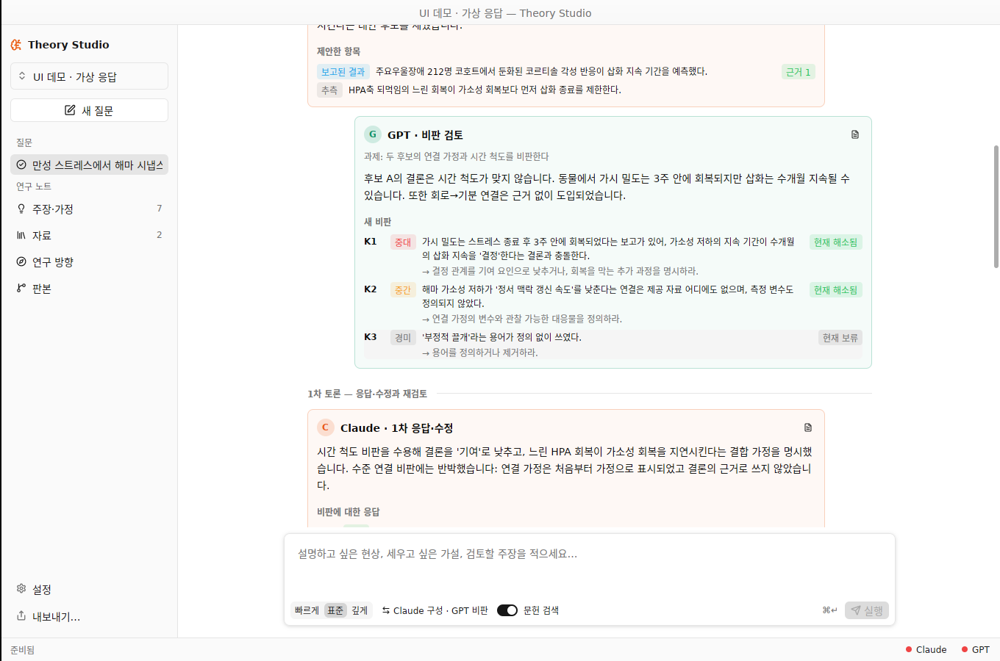

# Theory Studio

신경생물학 가설을 **Claude와 GPT가 서로 비판하고 수정하며** 세우는 로컬 데스크톱 앱. 모든 주장은 원문과 글자 단위로 대조한 근거·가정·추측으로 구분되고, 해소되지 않은 이견은 지우지 않고 남깁니다. Rust + GPUI Kit, SQLite, Codex App Server와 Claude Code 구독 연결을 사용합니다.



v0.3의 진단과 변경 내역은 [docs/diagnosis-v0.3.md](docs/diagnosis-v0.3.md)에 있습니다.

## 작동 방식

```text
계획 (구성 모델) → 문헌 검색 → 초기 작업: 초안·대안 후보 (구성 모델)
  → 첫 비판 (비판 모델)
  → 반복: 저자 응답·수정 (구성 모델) → 재판정 + 새 비판 (비판 모델)
  → 종합 (구성 모델): 결론 · 근거 · 남은 이견 · 다음 확인
```

- **토론 구성**은 설정이나 입력창에서 고릅니다: Claude 구성 · GPT 비판, GPT 구성 · Claude 비판, 또는 한 모델의 별도 문맥 비판.
- 비판마다 `K1, K2…` ID와 상태(미해결 / 해소됨 / 이견 유지 / 보류 / 비판 철회)가 붙습니다. 구성 모델은 수용·부분 수용·반박으로 답하고 이론을 고치지만 비판을 닫을 수 없습니다. 해소 여부는 비판 모델만 판정합니다.
- 중간·중대 비판이 모두 정리되거나, 같은 이견이 두 번 유지되어 진전이 없거나, 회차·호출·시간 한도에 닿으면 멈추고 종합합니다. 두 모델의 합의는 경험적 근거로 취급하지 않습니다.

| 범위 | 호출 | 비판 ↔ 수정 회차 | 시간 |
| --- | ---: | ---: | ---: |
| 빠르게 | 4 | 0 (첫 비판만) | 8분 |
| 표준 | 12 | 최대 2 | 25분 |
| 깊게 | 24 | 최대 4 | 50분 |

남은 시간이 수정 + 재검토 + 종합에 부족하면 새 회차를 시작하지 않습니다.

## 실행

```sh
cargo run --locked -p theory-studio
```

Rust 1.99.0은 `rust-toolchain.toml`로 고정합니다. UI는 `gpui-kit = 0.7.1`이며 전이 의존성은 `Cargo.lock`에 고정되어 있습니다. 별도 웹 서버·Python worker·LLM API 키가 필요하지 않습니다.

- **macOS (주 대상)**: `scripts/bundle.sh release` 후 `open 'dist/Theory Studio.app'`. 로컬 bundle은 ad-hoc 서명이며 공증된 배포판이 아닙니다. PDF는 번들된 PDFKit 도우미로 읽습니다.
- **Linux**: 빌드·실행됩니다. `libxkbcommon-dev`, `libxkbcommon-x11-dev`, Vulkan 또는 Mesa GL이 필요하고, PDF 본문은 poppler의 `pdftotext`로 읽습니다. 데이터는 `$XDG_DATA_HOME/theory-studio`에 저장합니다.

Codex와 Claude CLI는 앱에 포함하지 않고 설치된 공식 CLI를 탐지합니다(`~/.local/bin`, `/opt/homebrew/bin`, `/usr/local/bin`, PATH). 설정에서 경로를 지정할 수 있습니다. TinyFish 검색은 ScholarPen에 저장된 API 연결을 재사용하며, 없으면 PubMed만 사용합니다.

**UI 데모**: 구독 없이 화면을 확인하려면 스크립트 응답(가상)으로 만든 프로젝트를 엽니다. 실제 모델 응답이 아니며 제목과 모델 이름에 그렇게 표시됩니다.

```sh
cargo run -p theory-engine --example demo_project -- /tmp/theory-demo
THEORY_STUDIO_DATA_DIR=/tmp/theory-demo cargo run -p theory-studio
```

## 사용 순서

1. 사이드바 위의 **프로젝트 전환**에서 프로젝트를 열거나 만듭니다. ScholarPen 연구 폴더도 열 수 있고, 그 폴더의 `resources`/`resource` 아래 논문·책(PDF, EPUB, DOCX, Markdown, TXT, QMD)을 자동으로 읽습니다.
2. 하단 상태줄의 Claude · GPT 점이 연결 상태입니다(시작할 때 확인). **설정**에서 로그인, 모델 선택, 응답 테스트(구독 호출 1회)를 합니다. Codex는 앱 전용 ChatGPT 로그인, Claude는 기존 Claude Code 구독을 사용합니다.
3. **연구 방향**에 프로젝트의 목적·관점·제약을 적습니다(선택).
4. 질문을 입력하고 범위·토론 구성·문헌 검색을 고른 뒤 **실행**(⌘↵)합니다.
5. 실행 중에는 **토론** 탭에서 두 모델의 의견 교환이 회차별로 쌓입니다. 비판을 누르면 그 비판의 전체 경과(제기 → 응답 → 판정)가 오른쪽 검토 패널에 열립니다.
6. **답변** 탭: 결론, 작업 이론(주장 종류·원문 근거 수·이견 표시), 남은 이견. **근거** 탭: 출처별 인용과 판정, 인용 행이 강조된 원문. **작업 기록**: 계획과 각 호출의 실제 요청·응답.
7. **주장·가정**에서 항목을 채택·철회하거나 그 항목에 후속 질문을 합니다. **판본**에서 과거 원장을 새 작업안으로 복원하고, **내보내기…**로 Markdown(토론 기록·비판 원장 포함)·JSON·SQLite·첨부 원문 bundle을 저장합니다.

`⌘N` 새 질문 · `⌘Enter` 실행 · `⌘O` 자료 추가 · `⌘F` 자료 검색 · `⌘E` 내보내기 · `⌘,` 설정. 일반 Enter는 줄바꿈이며 실행하지 않습니다.

## 데이터와 실행 경계

- 공유 프로젝트의 연구 기록: `<연구 폴더>/.theory-studio/project.sqlite` 및 자산. 앱 내부 프로젝트와 연결 설정·인증은 앱 데이터 디렉터리(macOS `~/Library/Application Support/Theory Studio/`)에 보관합니다. `THEORY_STUDIO_DATA_DIR`로 바꿀 수 있습니다.
- DB는 WAL + FULL 동기화, 변경은 transaction입니다. 원장은 SQLite가 기준이고 JSON/Markdown은 내보내기 형식입니다. 앱 수준 단일 writer 잠금을 씁니다.
- 예산 예약과 요청 문맥을 호출 전에 저장합니다. 재시작 시 미완료 작업을 `interrupted`로 바꾸고 자동 재전송하지 않습니다.
- 모델 출력 검증: 엔진이 제안 ID를 부여하고, 원문과 일치하지 않거나 전송하지 않은 범위의 인용, 없는 참조는 **항목 단위로 제외**하고 사유를 기록합니다. 그다음 구조·ID·의존 관계·출처 hash·정확한 인용 문자열과 행 범위 검사를 통과한 것만 원장 제안이 됩니다. 이 검사는 논문의 결론이나 모델 추론이 참임을 보장하지 않습니다.
- 서버 혼잡·rate limit은 최대 2회 재시도하며 각 시도가 호출 예산에 포함됩니다. 원격 완료 여부가 불명확한 호출은 재전송하지 않습니다. 한 단계가 실패해도 종합은 진행하며, 종합까지 실패하면 검증된 중간 결과로 부분 보고서를 만듭니다.
- 모델에 shell과 파일 쓰기를 허용하지 않습니다. 문헌 검색은 앱의 읽기 전용 PubMed/TinyFish 연결에서 수행합니다(실행당 검색어 최대 2개). 출처 묶음은 요청당 약 140 KB 안에서 출처별로 나누고, 넘치면 관련도가 낮은 출처를 제외했다고 문맥에 명시합니다.
- 두 모델의 이름은 서로의 문맥에 넣지 않습니다. 비판 모델 연결이 실패하면 조용히 다른 모델로 바꾸지 않고 토론을 멈춘 뒤 '부분 답변'으로 표시합니다.
- API 결제 경로·자동 fallback이 없습니다. 구독 사용량은 계정의 다른 앱과 공유합니다.

## 현재 범위

v0.3: 저자 ↔ 비판자 재귀 토론, 비판 원장, 항목 단위 검증, 재시도, 문맥 예산, 재설계한 UI, Linux 빌드. 스캔 PDF OCR, 유료·접근 제한 원문 다운로드, 수치 실행, 시각적 주장 그래프, 분기 병합, 토론 중 사용자 개입은 후속 범위입니다.

## 검증

```sh
cargo fmt --all --check
cargo clippy --workspace --all-targets -- -D warnings
cargo test --workspace
cargo run -p theory-engine --example provider_check -- claude
cargo run -p theory-engine --example provider_check -- codex
# 아래 명령은 실제 구독 호출 1회를 사용합니다.
cargo run -p theory-engine --example provider_check -- claude --generate
```

Fixture provider는 테스트와 데모 예제에만 있습니다. 앱 UI에는 가상 응답을 실제 모델 응답으로 표시하는 경로가 없습니다. 실제 실행 근거와 미검증 항목은 [docs/QA.md](docs/QA.md)에 기록합니다. 여덟 연구 사례의 수동 평가 계약은 `docs/workflow-validation-cases.json`에 있습니다.
