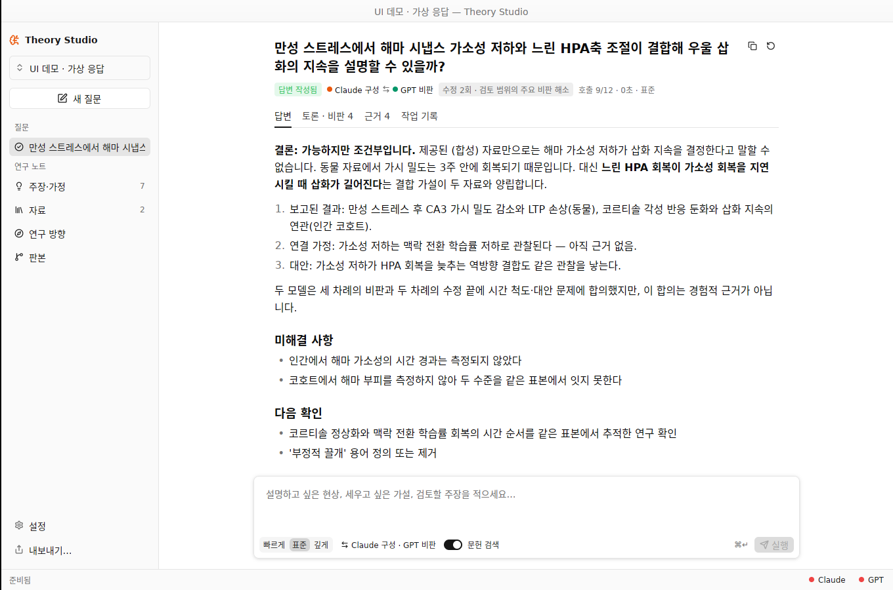
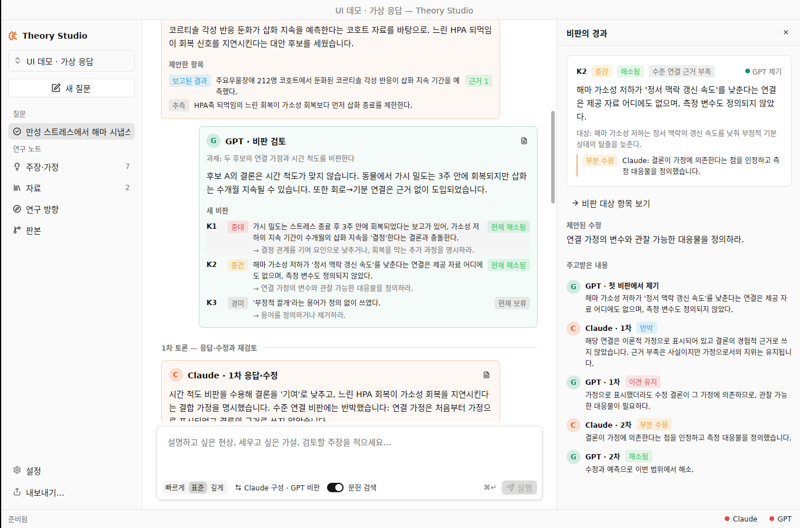
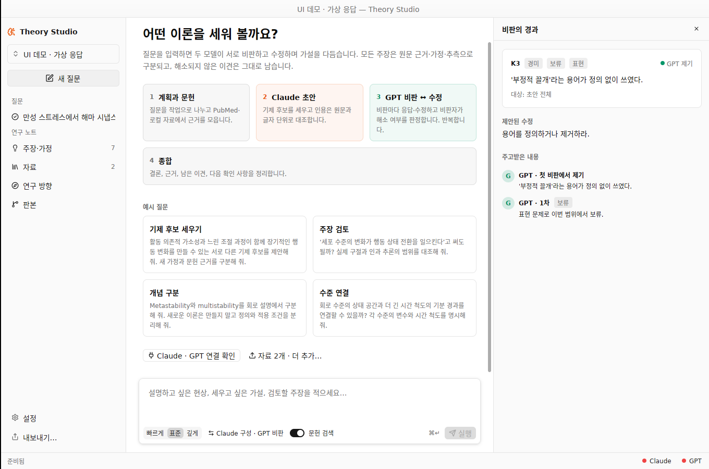

# v0.3 진단과 수정 — 2026-10-13

v0.2 코드를 처음부터 읽고, Linux에서 빌드·테스트·실제 GPUI 창 렌더링(Xvfb)으로 확인한 결과다. 구독 모델 호출은 이 환경에 로그인이 없어 실행하지 않았다. 아래 "검증" 절에 범위를 따로 적었다.

## 요약

| 문제 | 영향 | 수정 |
| --- | --- | --- |
| **Claude ↔ GPT 재귀 교환이 구현되어 있지 않음** | 앱의 핵심 목적이 코드에 없음. 비판은 쌓이기만 하고 아무도 응답·수정하지 않음 | 엔진이 주도하는 저자 ↔ 비판자 토론 루프, 비판 ID·상태·이력 |
| 검증이 전부 아니면 전무 | 인용 하나만 틀려도 작업 전체 폐기 → 의존 작업 차단 → 부분 답변 | 항목 단위 격리(quarantine), 엔진이 ID 부여 |
| 오류 하나가 실행 전체를 중단 | 서버 혼잡 1회에 종합 답변 소실 (QA의 실제 사례) | 일시 오류 제한 재시도, 실패 단계만 실패 처리, 부분 보고서 |
| 문맥 크기 무제한 증가 | 자료·원장이 커지면 240 KB 한도 초과로 호출 거부 | 출처 묶음 예산 배분, 관련 원장만 전달 |
| macOS 전용 빌드 | 다른 OS에서 engine이 컴파일되지 않음 | 플랫폼 모듈, PDF는 pdftotext 대체 |
| UI가 모델 간 교환을 보여 주지 않음 | 무엇이 어떻게 수정됐는지 알 수 없음, 디버그 출력 노출 | 질문 화면을 답변/토론/근거/작업 기록으로 재설계 |

## 1. 진단

### 1.1 재귀적 의견 교환이 없었다 — 가장 큰 벽

- `execution.rs`는 planner가 만든 DAG를 한 번 순서대로 실행하고 끝났다: 계획 → 분석/후보 구성 → 비판 → 종합.
- `cross_review` 설정은 Critic 작업 하나만 다른 provider로 보낼 뿐이었다. 구성 모델이 비판에 응답하고 이론을 고치는 단계, 비판 모델이 그 수정을 다시 판정하는 단계, 언제 멈출지의 판단이 모두 없었다. README에도 "다회차 수렴"과 "검토자에 의한 비판 처분 변경"이 미구현으로 적혀 있었다.
- 데이터 모델이 이를 막고 있었다. `Critique`에 ID와 상태가 없어 "어떤 비판에 무엇이라 답했고 해소됐는지"를 기록할 수 없었다. 비판은 "미해결 제안"으로만 남았다.
- 계획서 예산 표의 "최대 검토·수정 회차"도 코드에 존재하지 않았다.

### 1.2 검증이 전부 아니면 전무

- `Envelope::validate`는 인용 하나가 원문과 다르면 그 작업의 산출물 전체를 거부했다. 작업이 실패하면 그 결과에 의존하는 작업은 모두 차단되고 실행은 부분 답변이 된다. 긴 출력에서 인용 한두 개가 어긋나는 일은 흔하다.
- 모델이 새 제안 ID를 `output_id_prefix`로 시작하지 않으면 전체 거부. ID 관리를 모델에게 맡긴 구조였다.
- 존재하지 않는 의존 ID 하나, 찾을 수 없는 비판 대상 하나도 전체 거부 사유였다.

### 1.3 오류 하나가 실행 전체를 중단

- 각 작업 호출 결과가 `self.call(...)?`로 그대로 전파되어, 한 작업의 provider 오류가 실행 전체를 `Failed`로 끝냈다. QA 기록의 `serverOverloaded` 사례에서 종합 답변이 만들어지지 않은 원인이다.
- 계획서의 "일시적 연결·rate limit 오류는 횟수를 제한해 재시도"가 구현되지 않았다.
- planner 호출 자체가 실패하면 보수적 recipe로 넘어가지 않고 종료했다.

### 1.4 문맥 크기

- 문헌 검색 결과는 모든 작업에 붙고 출처마다 최대 12 KB를 보낸다. 자료가 20개를 넘으면 요청이 240 KB 한도를 넘어 호출 전에 거부될 수 있었다.
- 대상을 지정하지 않은 질문마다 원장 전체를 보냈다. 질문이 쌓일수록 같은 한도에 도달한다.

### 1.5 이식성과 빌드

- `env!("THEORY_EXTRACT_BUILD")`는 macOS의 build.rs에서만 정의되므로 다른 OS에서는 engine이 컴파일되지 않았다.
- `/usr/bin/open`, `~/Library/Application Support` 경로가 하드코딩되어 있었다.
- "새 프로젝트"는 ScholarPen이 설치되지 않아도 항상 `~/ScholarPen/<이름>` 폴더를 만들었다.
- 원래의 GPUI 통합 테스트는 대화상자 열림 애니메이션 도중에 클릭해 입력이 들어가지 않았다(이 환경에서 원본 코드로 재현). 시간에 의존하는 불안정한 테스트였다.

### 1.6 그 밖의 동작

- 서비스가 변경이 없어도 15초마다 전체 프로젝트 스냅샷(모든 원문 텍스트 포함)을 UI로 보냈다.
- 모델 연결 상태는 설정 화면을 열어야만 확인되었다.

### 1.7 UI·디자인

v0.2의 같은 실행을 표시한 화면: [before-v0.2.png](screenshots/before-v0.2.png)

- **앱의 핵심 가치인 모델 간 교환이 화면 어디에도 없었다.** 단계는 "진행 상황 보기"를 눌러야 역할 이름 목록과 원시 JSON으로만 보였다.
- Rust `{:?}` 디버그 출력이 그대로 노출되었다: `Claim · Proposed · Unreviewed`, `PartialSupport`.
- 내부 상태 문자열이 상단에 상주했다: "기존 로컬 프로젝트 · 자료 n개 · 본문 준비 n개 · r7".
- 상태·진행·중단 버튼이 세 곳(상단 메타, 활동 패널, 하단 상태줄)에 중복되었다.
- 사이드바에 페이지 메뉴, 프로젝트 폴더 목록, 최근 질문이 섞여 있었고 설정이 연구 페이지와 같은 위계였다.
- 버튼이 설명문 역할을 했고("이 제안의 근거·비판 검토", "연결된 전제 · …"), 컴포넌트 버튼은 라벨을 가운데 정렬하므로 목록이 읽기 어려웠다.
- 검토 패널이 원문 전체와 요청 JSON 전체를 매 프레임 markdown으로 렌더했다. 큰 PDF에서는 수 MB를 렌더링한다.
- 검토 패널을 열면 resizable 그룹이 모든 패널 크기를 비율로 다시 계산해 사이드바가 줄어들었다.

## 2. 수정

### 2.1 Claude ↔ GPT 재귀 토론 엔진

```text
계획 (구성 모델) → 문헌 검색 → 초기 작업: 초안·대안 후보 (구성 모델)
  → 첫 비판 (비판 모델)
  → 반복: 저자 응답·수정 (구성 모델) → 재판정 + 새 비판 (비판 모델)
        멈춤: 주요 비판 해소 · 진전 없음 · 회차/호출/시간 한도 · 비판 모델 연결 실패
  → 종합 (구성 모델): 결론 · 근거 · 남은 이견 · 다음 확인
```

- 비판마다 엔진이 `K1, K2…` ID를 붙이고 상태(미해결 / 해소됨 / 이견 유지 / 보류 / 비판 철회)와 응답·판정 이력을 저장한다 (`CritiqueRecord`).
- 구성 모델은 `critique_responses`(수용 / 부분 수용 / 반박 + 수정한 항목 ID)로만 답한다. 상태 변경은 비판 모델의 `critique_reviews`만 가능하다. 저자 출력에 판정이 들어 있으면 엔진이 버리고 기록한다.
- 두 모델의 이름은 서로의 문맥에 넣지 않는다(author / critic 역할만). 저자 쪽 문맥에 비판 모델 이름이 들어가지 않는 것을 테스트로 확인한다.
- 수정안은 `replaces_id`로 이어지고, 원장에는 마지막 판본만 제안으로 등록된다. 중간 초안은 실행 기록에 남는다.
- 종료 조건: 중간·중대 비판이 모두 정리되면 "검토 범위의 주요 비판 해소". 같은 비판이 두 번 이견 유지되거나 한 회차에 아무 변화가 없으면 "진전 없음 · 이견 보존". 한도에 닿으면 그 사유. 해소되지 않은 비판은 숨기지 않고 답변과 원장에 '이견 있음'으로 남는다.
- 비판 모델 연결이 실패하면 조용히 같은 모델로 바꾸지 않는다. 토론을 멈추고 사유를 기록하며 실행을 '부분 답변'으로 표시한다.
- 범위: 빠르게(호출 4 · 수정 0) / 표준(12 · 최대 2회) / 깊게(24 · 최대 4회). 시간 한도는 8 / 25 / 50분이며, 남은 시간이 수정 + 재검토 + 종합에 부족하면 새 회차를 시작하지 않는다.

### 2.2 검증과 오류 처리

- `Envelope::namespace_ids`: 엔진이 ID를 작업 namespace로 재부여하고 의존·인용·비판 참조를 함께 바꾼다.
- `Envelope::sanitize`: 원문과 일치하지 않는 인용, 전송하지 않은 범위의 인용, 없는 의존 참조, 순환, 잘못된 심각도·비판 대상을 항목 단위로 제외·정규화하고 사유를 검증 기록에 남긴다. 그다음 기존의 엄격한 `validate`를 통과해야 한다. **가짜 인용이 원장에 들어가지 않는다는 보장은 그대로다.**
- 서버 혼잡·rate limit은 5초, 15초 뒤 최대 2회 재시도한다. 각 시도는 호출 예산에 포함된다. 시간 초과처럼 원격 완료 여부가 불명확한 호출은 재전송하지 않는다.
- 작업 하나가 실패해도 그 작업만 실패로 기록하고 종합까지 진행한다. 로그인·사용량 소진처럼 다음 호출도 실패할 오류만 실행을 멈춘다.
- planner 호출이 실패하면 보수적 recipe를 사용한다. 호출 예산이 남지 않은 단계는 '보류'로 기록하고 종합은 수행한다.
- 종합이 실패하면 코드가 검증된 중간 결과(마지막 단계 요약, 작업 이론, 남은 비판)로 부분 보고서를 만든다. 답변을 지어내지 않는다.

### 2.3 문맥 관리

- 출처 묶음에 140 KB 예산을 두고 출처별 창을 고르게 나눈다. 짧은 초록이 남긴 여유는 긴 원문에 쓰고, 최소 창으로도 들어가지 않으면 어휘 관련도가 낮은 출처를 제외한 뒤 `omitted_sources`로 문맥에 명시한다.
- 대상 없는 질문에는 채택 항목과 질문과 어휘가 겹치는 제안 최대 40개(의존 관계까지 포함)만 보낸다.

### 2.4 UI 재설계

| 답변 | 토론 |
| --- | --- |
|  |  |
| **비판의 경과** | **새 질문** |
|  |  |

스크린샷은 `demo_project` 예제의 **가상 응답**으로 만든 화면이다. 실제 모델 출력이나 과학적 주장이 아니다.

- 질문 화면 머리: 질문, 상태, "Claude 구성 ⇄ GPT 비판", 수정 횟수와 종료 사유, 호출 수·시간. 탭 4개: **답변 / 토론 / 근거 / 작업 기록**.
- **토론 탭**: 회차별 타임라인. 구성 모델은 왼쪽, 비판 모델은 오른쪽, 모델마다 고정 색(Claude 주황, GPT 초록). 각 단계에 요약, 새 비판(심각도·현재 상태), 비판에 대한 응답(수용·반박), 이전 비판 판정, 수정·추가한 항목, 원문과 일치하지 않아 제외된 인용 수.
- 비판을 누르면 검토 패널에 그 비판의 **전체 경과**(제기 → 응답 → 판정 …)가 열린다.
- **답변 탭**: 결론 → 작업 이론(번호 목록, 주장 종류·원문 근거 수·이견 표시) → 남은 이견과 미해결 비판 → 실행 메모.
- **근거 탭**: 출처별 인용과 판정(지지/부분 지지/반박), 원문 보기(인용 행 강조, ±12행 창), 검증에서 제외된 인용 목록.
- 모든 상태·종류를 한국어 라벨과 색 칩으로 표시한다. 색만으로 의미를 전달하지 않는다.
- 상태는 하단 상태줄 한 곳과 실행 중인 질문의 진행 카드에만 표시한다. 상태줄 오른쪽에 Claude/GPT 연결 점(시작 시 백그라운드로 확인).
- 사이드바: 프로젝트 전환(대화상자), 새 질문, 질문 목록(상태 아이콘), 연구 노트(주장·가정 · 자료 · 연구 방향 · 판본, 개수), 하단에 설정·내보내기. 고정 폭이라 패널을 열고 닫아도 흔들리지 않는다.
- 입력창: 카드형. 범위(빠르게/표준/깊게, 툴팁에 호출·시간·회차), 토론 구성(누르면 구성·비판 모델 교대), 문헌 검색 스위치, ⌘↵.
- 설정: 토론 구성 4가지(교차 2종, 단독 2종), 모델 연결 카드, 문헌 검색, 화면(다크 모드·글자 크기), 프로젝트.
- 검토 패널은 고정 폭이며 원문과 요청 JSON을 범위를 제한해 렌더한다.
- Markdown 내보내기에 토론 기록과 비판 원장(각 응답·판정 포함)을 넣었다.

### 2.5 이식성

- `platform.rs`: 데이터 디렉터리(macOS `~/Library/Application Support/Theory Studio`, 그 외 `$XDG_DATA_HOME/theory-studio`)와 외부 열기(`open` / `xdg-open`).
- PDF 추출: macOS는 기존 PDFKit 도우미, 그 외에는 poppler `pdftotext`(같은 페이지 표식).
- ScholarPen 폴더가 없으면 새 프로젝트를 앱 내부 저장소에 만든다.

## 3. 검증

- `cargo fmt --all --check`, `cargo clippy --workspace --all-targets -- -D warnings` 통과.
- `cargo test --workspace`: **54개 통과** — core 8, engine 단위 15, 토론 7, 공유 폴더 7, 실행·저장 14, GPUI 3.
  - 토론: 두 모델 교대 순서, 수렴, 이견 유지 → 진전 없음, 빠르게 범위, 서버 혼잡 재시도, 비판 모델 로그인 실패 시 대체 없음, 저자의 판정 무시, 재시도로 예산이 모자랄 때 단계 보류 후 종합, Markdown 내보내기.
  - GPUI: 프로젝트 대화상자·한국어 입력·일반 Enter 비실행·검토 패널·전환 시 초안 보존, 토론 타임라인 렌더와 비판 경과 열기.
- Linux(Xvfb, Mesa)에서 실제 GPUI 창을 띄워 모든 화면을 클릭하며 확인했다. 라이트·다크 모드.
- `cargo run -p theory-engine --example demo_project -- <dir>`: 스크립트 응답으로 실제 엔진 경로(계획 → 후보 2개 → 비판 → 2회 수정·재검토 → 종합)를 통과한다. 결과: 비판 4개, 수렴, 원장 7개.

**미검증**: 실제 Claude·Codex 구독 호출(이 환경에 로그인 없음), macOS 빌드·번들·서명(Linux에서 작업), 실제 모델이 새 `critique_responses`/`critique_reviews` 계약을 얼마나 잘 지키는지와 토론 품질. 스키마는 기존과 같은 strict 규칙(모든 필드 required, nullable 허용)으로 생성되며 core 테스트가 이를 확인한다.

## 4. 다음 단계

1. macOS에서 `scripts/bundle.sh release` 후 **표준** 범위로 실제 질문 1회 실행. 토론 탭에서 비판·응답이 주제에 맞게 오가는지, 몇 회차에 멈추는지 확인.
2. 실제 실행에서 제외된 인용 비율을 보고 출처 창 크기(현재 출처당 최대 12 KB)를 조정.
3. 필요하면: 토론 회차 사용자 지정, 특정 비판을 보류·강제 재검토하는 사용자 개입, 선택적 API 키 provider.
