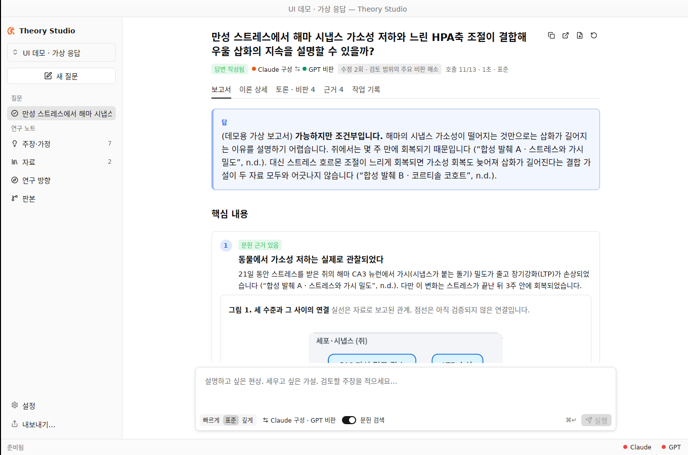
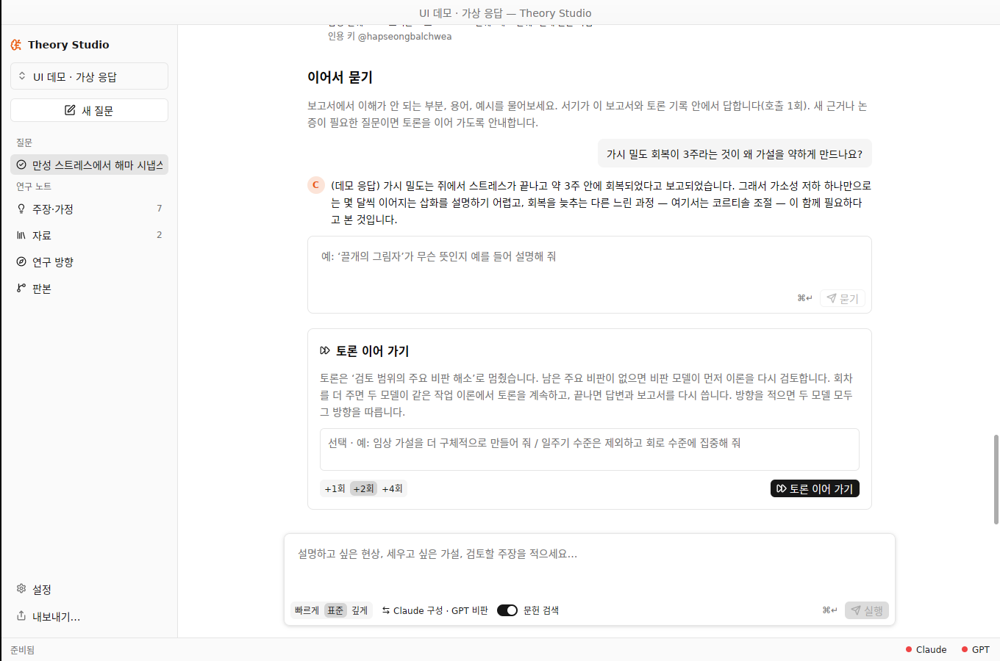
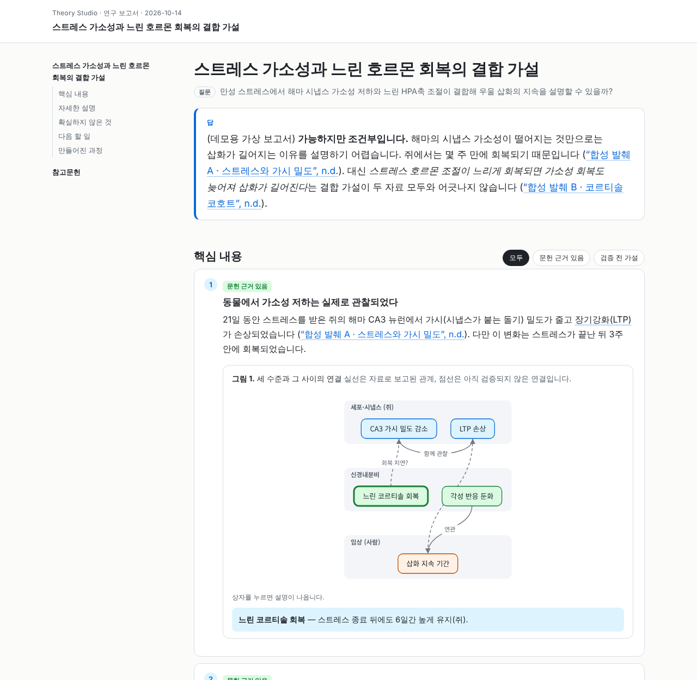

# v0.4 — 서기(읽기 쉬운 보고서), 학술 인용 내보내기, 토론 이어 가기 — 2026-10-14

실제 사용자 보고서(`dst-for-mood-disorder` 프로젝트의 report.md)를 읽고 나온 피드백을 고친 판본이다. 무엇이 문제였는지, 무엇을 바꿨는지, 무엇을 검증했고 무엇은 검증하지 못했는지 적는다.

## 1. 진단 — 사용자가 막힌 지점

| 사용자가 겪은 문제 | 원인 | 수정 |
| --- | --- | --- |
| 내보낸 report.md에 **넣어 둔 참고자료 원문이 통째로** 들어감 | `markdown()`이 `## 출처` 절에 모든 출처의 행 번호 붙은 전문(`s.numbered()`)을 붙였다 | 보고서에는 원문을 넣지 않는다. 인용은 `[@키]`, 서지는 `references.bib`. 원문을 담는 것은 별도 선택지인 **백업 bundle**뿐 |
| 답변에 `run-7009ed87_revise-r1-P3`, `K1–K12` 같은 **내부 ID**가 그대로 나옴 | 종합 단계가 원장 ID로 논증하도록 지시받았고, 그 결과가 그대로 사용자 답변이었다 | 토론에 참여하지 않은 **서기**가 독자를 위해 다시 쓴다. 서기 문맥에는 ID 대신 ‘작업 이론 n’ 같은 번호만 들어가고, 출력에 남은 ID는 엔진이 지우거나 바꾼다 |
| ‘미해결 사항’이 **제안자와 비평자의 토론 기록** | 종합의 `unresolved`가 비판 원장 요약이었다 | ‘아직 확실하지 않은 것’: 독자가 궁금해할 질문 · 왜 중요한가 · 무엇이 있으면 판가름 나는가 |
| ‘다음 확인’이 **무엇을 하라는 것인지** 모름 | 행위자·방법이 없는 문장(“~을 확인한다”) | ‘다음에 해 볼 수 있는 일’을 종류별로: 이 앱에서 이어서 묻기 · 이론·모형 작업 · 자료 분석 · 새 실험·측정 · 더 읽을 것, 각각 **무엇을 알게 되는지** 함께 |
| ‘작업 이론’이 이론의 부분인지 중간 산물인지 모름 | 설명 없이 원장 항목을 나열 | ‘이론 상세’ 탭으로 옮기고 “보고서의 재료가 된 가설 조각, 아직 채택 전”이라고 밝힘. 보고서에서는 각 핵심 내용에 **확실성**(문헌 근거 있음 · 논리적 도출 · 검증 전 가설 · 추측)을 붙임 |
| 글만 있어 이해하기 어려움 | 그림·표·용어 풀이가 없음 | 서기가 그림(수준·단계를 띠로 나눈 개념도)과 비교표, 용어 풀이를 만든다. 앱 안에서 바로 보이고, 내보낸 HTML에서는 상자를 누르면 설명이 나온다 |
| 대화가 중간에 멈춤 | 범위별 회차 한도(깊게 4회)에 닿으면 끝 | **토론 이어 가기**(+1/+2/+4회, 방향 메모)와 **이어서 묻기**(보고서에 대한 후속 질문) |

## 2. 바뀐 흐름

```text
계획 → 문헌 검색 → 초안 → 비판 ⇄ 응답·수정 … → 종합 (구성 모델)
  → 서기 (구성 모델의 별도 문맥, 토론 불참): 읽기 쉬운 보고서
       답 · 핵심 내용(확실성) · 그림/표 · 자세한 설명 · 용어 풀이
       · 아직 확실하지 않은 것 · 다음에 해 볼 수 있는 일 · 만들어진 과정
  ↺ 토론 이어 가기 (사용자 방향 포함) → 다시 종합 → 다시 보고서
  ↺ 이어서 묻기 (서기가 보고서·토론 안에서 답, 새 근거가 필요하면 토론 이어 가기를 권함)
```



### 서기

- `ReaderReport` 계약(`crates/core/src/report.rs`): `answer`, `key_points`(확실성·그림 참조), `sections`, `figures`(개념도: 노드·간선·띠 / 표: 열·행), `glossary`, `open_questions`, `next_steps`(종류), `how_made`, `bibliography`. strict 스키마이며 enum은 `oneOf`가 아닌 `enum`으로 나간다(변형 doc comment를 일반 주석으로 둔 이유).
- 서기 문맥(`crates/engine/src/execution/reader.rs`)에는 결론, 번호 붙은 작업 이론과 그 **검증된 인용**(인용 키·관계·구절), 비판의 쟁점·마지막 응답·판정, 토론 통계, 참고문헌 키만 들어간다. 모든 내부 ID는 미리 ‘작업 이론 n’, ‘비판 n’, 저자–연도로 바뀐다.
- 엔진 검증(`ReaderReport::sanitize`): 괄호 속 내부 ID는 지우고 나머지는 독자 표현으로 바꾼다. 없는 인용 키는 지운다. 그림 ID·간선·표 크기를 맞춘다. 고친 내용은 기록에 남는다.
- 서기는 서지 정보도 돕는다: 파일 이름밖에 모르는 자료에 대해, 원문 첫머리에 **인쇄된** 제목·저자·연도·학술지·DOI만 옮겨 적게 하고, 엔진이 각 값이 실제로 그 첫머리에 있는지 글자 단위로 확인해 통과한 것만 쓴다(`verify_candidate`).
- 서기가 실패해도 연구 결과(상태·원장)는 바뀌지 않는다. 보고서 탭이 토론 종합을 정리한 기본 화면과 **‘읽기 쉬운 보고서 만들기’**(호출 1회) 버튼을 보여 준다. v0.3 이전에 실행한 질문도 이 버튼으로 보고서를 만들 수 있다.
- 호출 예산은 범위마다 1회 늘었다: 빠르게 5 · 표준 13 · 깊게 25. 모든 단계의 예약(reserve)이 종합과 보고서 두 호출을 남긴다.

### 토론 이어 가기 · 이어서 묻기



- **토론 이어 가기**(`execution::resume`): 끝난 질문에 회차를 더한다. 같은 모델 짝, 같은 작업 이론과 비판 원장에서 계속한다. 이미 두 번 ‘이견 유지’된 비판도 한 번 더 다룬다(`resumed_at` 이후로 다시 셈). 남은 주요 비판이 없으면 비판 모델이 먼저 이론을 다시 검토한다. 사용자의 **방향 메모**는 두 모델·종합·서기 모두에게 “사용자가 준 과제 의도(근거 아님)”로 전달되고 토론 탭에 표시된다. 이론과 비판이 하나도 바뀌지 않으면 답변과 보고서를 다시 쓰지 않는다. 시간 추정은 이번 이어 가기에서 쓴 호출만으로 한다(어제 실행한 질문도 이어 갈 수 있도록).
- **이어서 묻기**(`execution::ask`): 보고서 아래 입력창. 서기가 보고서·작업 이론·비판 안에서 답하고, 새 근거나 논증이 필요한 질문이면 그렇게 말하고 토론 방향을 제안한다(“이 방향으로 토론 이어 가기” 버튼). 보고서의 ‘이 앱에서 이어서 묻기’ 항목은 누르면 입력창에 들어간다.

### 내보내기



‘내보내기…’(⌘E)는 세 가지를 고른다.

1. **이 질문의 보고서** / 2. **프로젝트 전체 보고서** — 폴더 하나:
   - `report.md` — pandoc 문서. YAML(`bibliography: references.bib`, `link-citations: true`), 인용은 `[@키]`, 그림은 `figures/*.svg`, 마지막에 `::: {#refs}`. 예: `pandoc report.md --citeproc -o report.docx` 또는 Quarto.
   - `references.bib` — 보고서가 실제로 인용한 문헌만. PubMed 검색 결과는 PubMed의 저자·학술지·권·쪽·DOI, 인쇄된 DOI가 있는 자료는 Crossref, 그 밖에는 서기가 옮겨 적고 엔진이 확인한 값, 최후에는 파일 이름. 추측으로 채우지 않는다.
   - `report.html` — 외부 스크립트·글꼴 없이 혼자 열리는 인터랙티브 페이지: 확실성별 거르기, 그림 상자를 누르면 설명, 본문의 용어에 마우스를 올리면 풀이, 저자–연도 인용에서 참고문헌으로 이동, 라이트/다크, 휴대폰 폭.
   - `debate-record.md` — 부록: 토론 단계, 비판 원장(응답·판정), 원문과 대조한 짧은 인용(키와 행 번호), 연구 노트 항목. 자료 본문은 없다.
3. **백업 bundle** — 다른 컴퓨터에서 다시 가져오기 위한 전체 기록(원문 포함). 공유용이 아님을 화면에 적었다.

보고서 머리의 버튼으로 같은 HTML을 바로 브라우저에서 열 수 있다.

인용 키는 사람이 읽을 수 있게 만든다: `goldbeter2011model`, 한국어 저자·제목은 로마자 표기(`kim2024joulbyeongui`; 흔한 성은 관용 표기). 보고서가 한 번 인용한 키는 그 자료에 고정되어, 저장된 보고서 본문과 이후의 `.bib`가 항상 일치한다.

## 3. 검증

- `cargo fmt --all --check`, `cargo clippy --workspace --all-targets -- -D warnings` 통과.
- `cargo test --workspace`: **73개 통과** (core 15, engine 단위 19, 토론 13, 공유 폴더 7, 실행·저장 14, GPUI 5).
  - 서기: 문맥에 엔진 ID가 없음, 출력의 `K1`·작업 이론 ID 정리, 없는 키 `@invented` 제거, 원문 첫머리에 있는 제목만 서지로 채택하고 키를 새 제목으로 바꾼 뒤 고정, 형식이 틀린 보고서는 답변을 그대로 두고 나중에 다시 쓸 수 있음.
  - 내보내기: report.md의 YAML·`[@키]`·그림 경로·`#refs`, references.bib 항목, report.html의 인용 링크·그림 노드·외부 스크립트 없음, 부록의 토론 기록, **어떤 파일에도 자료 본문의 다른 줄이 없음**.
  - 이어 가기: 사용자 방향이 비판 모델 문맥에 들어가 새 비판 → 응답·수정 → 재검토 → 종합 → 보고서, 호출·회차 회계, 원장에 수정본 추가. 바뀐 것이 없으면 답변 유지. 하루 전에 시작한 질문도 시간 한도로 바로 멈추지 않음.
  - 이어서 묻기: 답의 내부 ID·없는 인용 정리, “토론이 더 필요” 표시.
  - 서지: PubMed XML(저자·CollectiveName·학술지·쪽·DOI), Crossref 레코드, DOI 추출, 이전 PubMed 메모 해석, BibTeX 이스케이프, 한국어 키.
  - GPUI: 보고서 탭(제안 질문 → 입력창, 회차 선택, 그림 캐시), 보고서가 없는 이전 질문의 ‘보고서 만들기’ 안내.
- 실제 창: Xvfb + Mesa에서 데모 프로젝트(스크립트 응답)를 열어 보고서·이론 상세·토론·내보내기 대화상자를 클릭해 확인했다. 내보낸 report.html은 Chromium으로 데스크톱·휴대폰 폭, 라이트·다크에서 확인했다.

## 4. 미검증

- 실제 Claude·Codex 구독 호출. 서기가 실제로 얼마나 읽기 쉬운 보고서를 쓰는지, 그림을 얼마나 적절히 고르는지는 실제 질문으로 확인해야 한다. 프롬프트(`SCRIBE_RULES`)는 사용자 피드백의 각 항목을 직접 금지·요구하도록 썼다.
- Crossref·PubMed 서지 보완은 이 환경에서 네트워크 호출 없이 파서만 검증했다.
- macOS 번들. 개념도는 GPUI의 SVG 렌더러(시스템 글꼴)로 그리며 Linux에서 Noto CJK로 확인했다.

## 5. 이후 수정 — 단계별 모델과 보고서 정리

사용자 피드백: 보고서가 조화롭지 않고(같은 그림이 두 번 나옴) 설명을 이해하기 어렵다. 최종 정리를 GPT가 하고 있다.

| 문제 | 원인 | 수정 |
| --- | --- | --- |
| 최종 정리를 GPT가 씀 | 종합과 서기가 모두 **구성 모델** 몫이었다(GPT 구성 · Claude 비판이면 GPT) | 설정에서 **구성 · 비판 · 정리**를 각각 고른다. 정리 모델이 종합, 읽기 쉬운 보고서, 이어서 묻기 답변을 쓴다. 기본값과 이전 설정 파일은 Claude. 토론 이어 가기는 구성·비판을 그 질문의 원래 모델로 유지하고, 정리는 지금 고른 모델이 맡는다 |
| 같은 그림이 두 번 | 서기가 한 그림을 핵심 내용과 자세한 설명 양쪽에 걸면, 앱·HTML·Markdown이 걸린 곳마다 다시 그렸다. 거의 같은 개념도를 두 개 만들기도 했다 | `ReaderReport::tidy_figures`: 거의 같은 그림(같은 종류, 상자·칸 70% 이상 공유, 또는 같은 제목)은 더 풍부한 쪽으로 합치고, 각 그림은 처음 걸린 곳에만 둔다. 저장된 보고서에도 화면에 보일 때 적용된다. 핵심 내용의 그림은 카드 안이 아니라 핵심 내용 목록 바로 뒤에 한 번 나온다 |
| 설명이 어렵고 흩어짐 | 서기 지시가 분량 상한 위주였고, 핵심 내용(120단어)과 자세한 설명(250단어)이 같은 말을 반복하기 쉬웠다 | `SCRIBE_RULES` 재작성: 요점 → 이유 → 예, 주어·동사가 분명한 짧은 문장, 명사 나열·번역투 금지, 용어는 처음 나올 때 풀어 씀. 핵심 내용은 1–3문장, 자세한 설명은 앞 절 위에 쌓아 가는 한 흐름(출발 사실 → 기제 → 구체 사례 → 한계). 그림은 서로 다른 것을 보여 주는 1–3개, 각 그림은 한 번, 캡션은 읽는 법 |
| 이미 만든 보고서를 고칠 방법이 없음 | ‘보고서 만들기’는 보고서가 없을 때만 보였다 | 보고서 위 **○○로 다시 쓰기 · 호출 1회**: 지금의 정리 모델과 작성 규칙으로 보고서만 다시 쓴다. 실패하면 이전 보고서를 유지하고 이유를 알린다 |

정리 모델이 비판 모델과 같은데 실행 중 그 모델을 쓸 수 없게 되면(로그인·사용량), 구성 모델이 종합과 보고서를 쓰고 그 사실을 기록에 남긴다. 조용히 바꾸지 않는다.

검증: `cargo test --workspace` 76개 통과(새로 추가: 그림 합치기·한 번만 보이기, 정리 모델 선택과 다른 모델로 다시 쓰기, 이전 설정 파일의 정리 모델 기본값, 비판·정리 모델 로그인 실패 시 구성 모델이 정리). clippy·fmt 통과. Xvfb + lavapipe에서 데모 프로젝트로 설정의 단계별 선택(저장 확인), 질문 머리의 ‘Claude 정리’, 다시 쓰기 버튼, 핵심 내용 뒤 그림 배치를 확인했다. 실제 구독 호출로 바뀐 서기 지시의 효과는 아직 확인하지 않았다.
