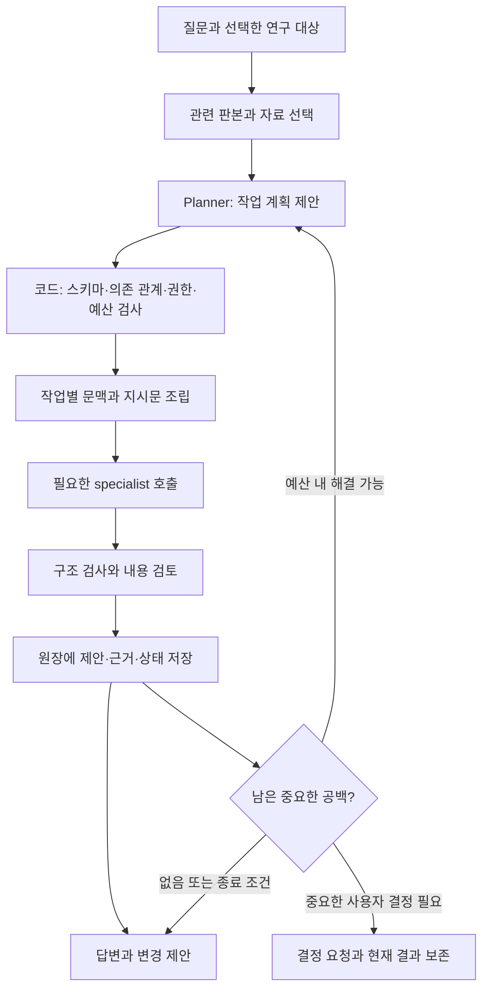

# Collaborative Agents — 연구 질문에 따라 구성되는 이론 탐구 데스크톱 앱

작성: 2026-10-13 · 상태: 구현 제안 v0.1 · 대상: 개인 연구용 macOS 앱

이 문서는 「다수준 동역학 이론 구성을 위한 agent 시스템 설계안」을 반복 사용 가능한 제품으로 확장한다. 원안의 주장·가정·근거 원장과 비판 절차를 유지하면서, 특정 질환·이론·역할 수·모델 조합에 대한 의존을 없앤다. 아래의 수치와 단계는 초기 구현 기본값 제안이며, 성능이나 과학적 타당성을 검증한 결과가 아니다. 앱 구현은 아직 시작하지 않았다.

**만들 제품은 ‘질문을 넣으면 필요한 연구 작업을 구성하고, 근거와 이견을 남기면서 기존 이론을 수정해 가는 작업실’이다.** 사용자는 연구 문제에 집중하고, 앱은 이번 질문에 필요한 역할과 지시문, 읽을 자료, 검토 절차를 조립한다.

## 1. 제품의 범위와 성공 조건

일차 대상은 신경생물학적 이론 탐구다. 기분장애의 다수준 동역학뿐 아니라 신경회로의 기제, 학습과 가소성, 인지 이론의 비교, 개념 정리, 문헌에 근거한 주장 검토 등에 같은 앱을 사용한다. 개념적·형식적·경험적 작업을 다루되, 모든 분야를 위한 범용 자동 연구 플랫폼까지 첫 버전에 넣지는 않는다.

한 프로젝트 안에서 다음 흐름이 이어져야 한다.

1. 사용자가 질문과 자료를 넣는다. 기존 후보나 특정 주장 하나를 선택하고 질문해도 된다.
2. 앱이 질문의 범위, 사용할 자료, 필요한 작업과 결과 형태를 짧게 보여 주고 실행한다.
3. 결과에는 직접적인 답, 근거가 있는 부분, 새로 둔 가정, 미해결 문제가 구분되어 있다.
4. 사용자가 “이 가정은 빼고 다시”, “두 후보의 차이만”, “이 논문이 반례인지”처럼 이어 묻는다.
5. 앱이 영향을 받는 주장과 작업만 다시 검토하고 이전 판본과의 차이를 남긴다.
6. 앱을 종료했다 열어도 질문·출처·후보·검토 상태·실행 이력이 복구된다.

성공은 에이전트의 수나 대화량으로 재지 않는다. **사용자가 결과의 어느 문장이 어디에서 왔고, 어떤 가정에 의존하며, 다음에 무엇을 확인해야 하는지 알 수 있어야 한다.**

## 2. 원안에서 유지할 것과 바꿀 것

| 원안의 요소 | 제품에서의 처리 | 이유 |
| --- | --- | --- |
| 주장·가정·비판·용어 원장 | 공통 코어로 유지 | 질문과 회차를 넘어 축적할 연구 기록 |
| 고정된 구성자와 세 비판자 | 질문별 작업으로 선택·조합 | 문헌 확인에 임상·수학 비판자를 항상 호출할 필요가 없음 |
| 여섯 단계의 순환 | 큰 이론 구성의 기본 recipe로 보존 | 간단한 질문에는 더 짧은 흐름이 적절함 |
| 양극성장애 설명 대상표 | 프로젝트별 평가 대상과 범위로 이동 | 다른 질환·현상·개념 질문에도 적용 |
| 수준 연결 유형 여섯 가지 | 선택 가능한 다수준 동역학 profile | 모든 문제를 수준 연결이나 DST로 해석하지 않도록 함 |
| Claude/GPT 고정 교차 배정 | provider와 역할을 분리한 선택 정책 | 한 provider로 시작하고 필요할 때 다양성을 추가 |
| 두 모델이 동의하면 처분 확정 | 판정 제안과 이견을 저장 | 일치는 경험적 근거나 진리 판정이 아님 |
| 매 회차 재구성 | 논증의 주요 판본 변경·최종 보고 때 실행 | 간단한 수정에 반복 비용이 과도함 |
| G1–G4에서 사용자 승인 | 중요 변경에서만 결정 요청 | 통상적인 검색·비판·수정 제안은 자율 진행 |
| 원장 전체를 구성자에게 전달 | 작업별로 선택한 판본과 근거 묶음 전달 | 맥락 비대화와 서로의 초안에 대한 선행 노출 방지 |
| 주장 그래프만 비판자에게 전달 | 구조 + 필요한 정의·문맥·출처 전달 | 그래프만으로는 주장 범위와 논증의 의미가 소실될 수 있음 |
| 용어 이탈을 기계적으로 판정 | 판본 차이는 코드, 의미 차이는 검토 제안 | 문자열 대조만으로 의미의 변화를 판정할 수 없음 |

원안의 “미해결 비판 0개 = 정합 후보”도 **“현재 검토 범위에서 미해결 비판 없음”**으로 표현한다. 검사에서 발견하지 못한 모순까지 없다는 뜻으로 확대하지 않는다. ‘표상’ 등 개념의 의미도 연결 유형만으로 자동 결정하지 않고 각 주장의 의도를 명시한다.

## 3. 공통 코어, 연구 profile, 실행 recipe

범용성은 역할 이름을 많이 만드는 데서 얻지 않는다. 다음 세 층을 분리한다.

| 층 | 담는 내용 | 변경 방식 |
| --- | --- | --- |
| 공통 코어 | 프로젝트, 질문, 작업, 주장, 가정, 출처, 비판, 판본, 실행 상태 | Rust 코드와 버전이 있는 저장 스키마 |
| 연구 profile | 용어 초안, 관찰 수준, 검토 관점, 평가 기준, 주의할 추론 | 앱에 포함된 JSON과 프로젝트별 설정 |
| 실행 recipe | 특정 질문에서 보통 필요한 작업·의존 관계·검사 | 계획 생성의 출발점. 질문에 따라 축소·조합 |

기본 profile은 `general-research`로 둔다. `neurobiology`와 `multilevel-dynamics`를 선택적으로 더한다. 원안은 `neurobiology + multilevel-dynamics`에 해당하는 하나의 활용 사례가 된다. 질환 이름, 수준의 개수, 설명할 현상은 profile이 아니라 프로젝트 내용이다.

profile에는 다음을 넣는다.

- 선택적 관점: 개념, 기제, 형식, 경험적 적합성, 측정, 대안 설명.
- 관찰 단위와 범위: 분자·세포·회로·행동 등의 자유로운 목록, 시간 규모, 종, 표본, 측정 방식.
- 연결 주장에 추가할 항목: 변수, 대응 관계, 성립 조건, 알려진 한계.
- 용어와 평가 항목의 초안. 연구자가 수정할 수 있으며 처음부터 확립된 사실로 취급하지 않는다.
- 작업별 출력 스키마와 점검 기준의 참조. 실행 권한과 예산은 profile이 확대할 수 없다.

새 분야를 추가할 때 핵심 DB 테이블이나 실행기를 고치지 않아야 한다. 분야 고유 필드는 namespace와 schema version이 있는 확장 필드로 저장한다. 초기에는 임의 plugin 코드나 스크립트를 불러오지 않는다.

자료·용어·가정의 기본 범위는 프로젝트다. 다른 프로젝트의 내용을 재사용할 때는 사용자가 선택한 참조와 원래 판본을 남긴다. 한 연구의 잠정적 가정이 다른 연구의 기본 사실로 유입되지 않게 한다. 실행 시작 시 profile과 recipe의 판본도 함께 고정한다.

## 4. 질문을 실행 가능한 작업으로 바꾸는 방법

### 4.1 질문 유형은 고정 메뉴가 아니라 계획의 입력이다

| 사용자의 질문 | 주된 작업 | 기본 결과 |
| --- | --- | --- |
| “이 두 개념은 무엇이 다른가?” | 개념 정리 → 구분 검토 | 정의·사용 문맥·혼동하기 쉬운 지점 |
| “이 주장을 실제로 뒷받침하는가?” | 출처 대조 → 주장 범위 검토 | 원문 위치와 지지/부분 지지/불일치/판단 불가 |
| “두 이론 중 무엇이 더 설명하는가?” | 공통 평가 기준 → 대칭적 비교 | 설명 대상별 비교와 추가 가정 |
| “이 현상을 설명하는 기제를 세워 보자” | 후보 구성 → 반례·대안 → 수정 | 구별 가능한 후보, 연결 가정, 남은 공백 |
| “이 설명을 최소 모형으로 옮겨 보자” | 변수·가정 명시 → 형식화 → 검사 | 수식·유도·검사 가능성; 실행 여부 별도 표시 |
| “어떤 관찰이 두 가설을 구분할까?” | 구별 예측 → 측정·혼란변수 검토 | 관찰 조건과 각 결과의 해석 |
| “새 논문 때문에 기존 틀을 바꿔야 하나?” | 영향 범위 추적 → 관련 주장 재평가 | 변경 제안과 기존 판본 대비 차이 |
| “지금까지의 이론을 문서로 정리해 줘” | 원장 기반 문서화 → 새 문맥 재구성 | 출처·가정·한계가 유지되는 이론 문서 |

하나의 질문은 여러 유형에 걸칠 수 있다. 예를 들어 비교 중 정의가 불명확하면 개념 작업을 선행시키고, 원문이 부족하면 근거 확인을 먼저 한다. 유형 분류 하나로 전체 흐름을 결정하지 않는다.

### 4.2 계획 생성과 실행 통제를 분리한다



LLM Planner는 의미를 해석해 계획을 **제안**한다. Rust 실행기는 허용된 작업만 수행하고 의존 관계, 취소, 예산, 저장을 책임진다. 모든 것을 하나의 ‘총괄 에이전트’ 프롬프트 안에서 처리하지 않는다.

계획에는 `QuestionSpec`, `TaskSpec[]`, `BudgetPolicy`, `StopPolicy`, `OutputSpec`이 들어간다. task 목록은 한 판본 안에서 순환이 없는 의존 관계 그래프(DAG)여야 한다. 반복은 순환 간선을 넣는 대신 새 plan revision의 새 task로 표현한다.

Planner가 만든 DAG를 실행하기 전에 다음을 검사한다.

- task ID의 유일성, 존재하는 입력·출력 참조, 순환과 교착 가능성.
- 허용된 역할 계열·도구·출력 스키마인지 여부.
- 질문의 각 요구가 적어도 하나의 산출물과 연결되는지, 불필요한 작업이 붙지 않았는지.
- 계획 전체와 재시도에 필요한 호출 수·시간이 실행 한도 안인지 여부.
- 검토 대상의 작성 이력과 검토 작업의 정보 노출 정책이 맞는지 여부.
- 현재 기능으로 수행할 수 없는 작업을 계획하지 않았는지 여부. 실행기가 없는 수치 실험을 ‘검증 예정’으로 숨기지 않는다.

잘못된 계획은 한 번의 수정 요청 후 보수적인 recipe로 축소한다. 질문 자체를 처리할 수 없으면 이유와 가능한 부분 결과를 남긴다. 계획 생성과 수정 호출도 예산에 포함한다.

### 4.3 작업별 지시문은 구체적인 계약으로 조립한다

| `TaskSpec` 필드 | 의미 |
| --- | --- |
| `id`, `kind`, `role_template_version` | 작업 식별자와 허용된 역할 계열 |
| `objective`, `question_id`, `target_ids` | 이번 호출이 답할 질문과 대상 주장·후보 |
| `context_refs`, `base_revision` | 읽을 자료·원장 항목의 정확한 판본 |
| `instructions`, `acceptance_checks` | 해야 할 분석과 완료 조건 |
| `depends_on`, `output_schema` | 선행 작업과 검증할 출력 형식 |
| `allowed_tools`, `visibility_policy` | 사용 가능한 도구와 보여 줄 정보 |
| `model_policy`, `limits` | 요구 기능·작성자와의 분리 정책·호출 한도 |

지시문은 `공통 연구 규칙 + 역할 템플릿 + 이번 질문의 목적 + 선택된 근거 + 출력 계약`으로 만든다. 예컨대 “까다로운 비판자가 되어라”보다 “C12의 연결 가정 A3가 관찰 O2만으로 정당화되는지 검토하고, 필요한 추가 전제를 명시하라”처럼 작성한다.

문헌과 첨부파일은 인용 가능한 **자료**다. 그 안의 명령문은 앱 권한이나 에이전트 지시를 바꾸지 못한다. 기존 초안의 제안 역시 사용자가 새로 내린 명령과 구별한다.

구체적인 배정과 지시문 예시는 [workflow_examples.md](./docs/workflow_examples.md)에 둔다.

### 4.4 재계획과 후속 질문

재계획은 원문 접근 실패, 중요한 반례 발견, 정의 충돌, 사용자 추가 지시처럼 이유가 있을 때 수행한다. 새 역할을 계속 추가해 같은 비판을 반복하지 않는다. 변경된 목적·작업·예산·이유를 저장한다.

후속 질문에서는 관련 주장과 의존 관계를 따라 입력을 고른다. 기존 실행 결과는 읽기 자료로 재사용할 수 있지만, 작업 결과 캐시는 입력 판본·출처 hash·템플릿·모델·도구 버전이 모두 맞을 때만 재사용한다. 모든 대화와 모든 문헌을 매 호출에 넣지 않는다. 원문을 잘라 전달할 경우 선택·제외 범위를 기록한다.

## 5. 에이전트 구성과 판정

역할은 상주하는 인격이나 운영체제 프로세스가 아니다. **작업 계약, 허용 도구, 별도 문맥을 가진 모델 호출 단위**다. 같은 모델이 서로 다른 역할을 맡을 수 있고, worker 수와 역할 수는 별개다.

| 역할 계열 | 호출 조건 | 주된 산출물 |
| --- | --- | --- |
| Planner | 새로운 질문, 근거 있는 재계획 | 작업 목록과 범위 해석 |
| Analyst | 정의·기제·비교 분석이 필요할 때 | 구조화된 설명 또는 비교 |
| Constructor | 새 가설이나 대안 구성이 필요할 때 | 후보·가정·의존 관계 |
| Evidence reviewer | 문헌에 기대는 주장을 할 때 | 출처 구절과 주장 대조 |
| Critic | 주요 추론·연결·비교를 검토할 때 | 대상이 명확한 비판과 판정 근거 |
| Formalizer | 수학적 또는 계산적 표현이 필요할 때 | 변수·수식·성립 조건·검사 계획 |
| Synthesizer / Reconstructor | 답변 작성 / 주요 논증 판본 검토 | 직접 답변 / 문서만으로 재구성한 논증 |

Critic의 관점은 작업마다 정한다. 임상 질문일 때만 임상적 범위를 추가하며, 신경생물학 질문이라고 항상 임상 비판자를 호출하지 않는다. 별도 ‘기록자 LLM’은 상시 운영하지 않는다. 원장 저장·ID 검증·참조 검사·지표 계산은 코드가 수행하고, 의미상의 중복·비판 처분은 검토 가능한 모델 제안으로 저장한다.

독립 생성이 필요한 두 후보는 같은 시작 판본과 서로 격리된 문맥에서 만든다. 두 출력이 저장되고 공개 단계에 도달하기 전에는 서로의 초안을 읽을 수 없다. 그래도 통계적으로 독립된 증거가 생긴 것은 아니다.

provider가 둘 이상이면 중요한 주장에 대해 다른 provider/모델의 검토를 선택할 수 있다. 하나만 연결되어 있으면 새 문맥 검토를 사용하고 “동일 모델 검토”로 기록한다. 필요한 독립성 수준을 충족하지 못했을 때 조용히 다른 정책으로 바꾸지 않는다.

비판에는 `open / addressed / contested / deferred` 상태와 심각도, 대상, 작성·검토 이력이 붙는다. 구성자가 자기 비판의 상태를 직접 닫을 수 없다. 검토자는 응답을 확인해 처분을 제안하고 실행기는 근거와 판본을 검사해 기록한다. 의견이 갈리면 양쪽을 보존한다. 이견이 있다는 이유만으로 매번 사용자에게 판정을 요구하지 않는다.

## 6. 자동 진행, 예산, 종료

기본 모드는 ‘범위 안에서 자동 진행’이다. 실행 계획 요약은 항상 열어 볼 수 있지만 매 단계 확인 버튼을 누르게 하지 않는다. 사용자는 진행 중에도 범위를 좁히거나 중단할 수 있다.

| 상황 | 기본 동작 |
| --- | --- |
| 명확한 질문, 기존 범위 안의 분석 | 계획을 표시하고 실행 |
| 중요하지 않은 모호함 | 선택한 해석을 밝히고 실행 |
| 모호함에 따라 조사 대상·결론이 크게 달라짐 | 초기에 한 번 질문; 독립 작업은 계속 |
| 새로운 반례나 미확인 출처 | 작업 추가 또는 ‘판단 불가’ 결과; 한도 내 자동 처리 |
| 모델 간 이견 | 이유와 후보를 병렬 보존; 반드시 사용자 대기로 바꾸지는 않음 |
| 잠근 전제·핵심 정의·채택 문서의 변경 필요 | 변경 전후와 영향을 제시하고 해당 변경만 대기 |
| 호출·시간·사용량 한도 도달 | 중단 이유와 부분 결과 저장; 자동으로 한도 확대 안 함 |

사용자가 이미 “이 가정을 제거해서 수정해 줘”라고 지시했다면 그 범위는 승인된 변경으로 처리한다. 같은 허락을 다시 받지 않는다. 질문만 했을 때는 채택한 이론 문서를 자동 교체하지 않고 수정안을 만든다.

초기 budget preset은 다음과 같이 제안한다. 사용 실험 후 조정하며 preset 이름이 과학적 신뢰도의 등급을 뜻하지는 않는다.

| 범위 | 최대 모델 호출 수 | 최대 검토·수정 회차 | 최대 재계획 | 실행 시간 상한 | 용도 |
| --- | ---: | ---: | ---: | --- | --- |
| 빠르게 | 4 | 1 | 0 | 5분 | 한 개념·주장 확인 |
| 표준 | 12 | 2 | 1 | 15분 | 비교·근거 검토·국소 수정 |
| 깊게 | 24 | 4 | 2 | 30분 | 여러 후보의 이론 구성 |

호출 예산에는 Planner, reviewer, 종합, 실패와 재시도가 모두 포함된다. 실행당 동시 모델 호출은 기본 2개 이하, task 노드는 최대 40개로 제한한다. 호출별 출력·시간 한도와 실행 전체 시간 한도를 별도로 두고 예약한 예산을 원자적으로 차감한다. 종합에 필요한 호출을 남겨 두되, 그마저 실패하면 코드가 완료·미완료 작업과 검증된 산출물을 모아 부분 보고서를 만든다.

provider adapter의 동시 실행이 검증되기 전에는 해당 provider를 한 번에 하나씩 호출한다. 위 상한은 완료 시간을 보장하는 약속이 아니며, 사용자 결정으로 명시적으로 멈춘 시간은 제외한다. 호출·회차·시간 중 먼저 도달하는 한도에서 멈춘다.

provider가 반환한 실제 사용량과 앱의 추정치는 구분한다. 구독 잔여량을 앱의 달러 비용으로 변환하지 않으며, 사용량을 모를 때 0으로 표시하지 않는다. 유료 API로의 자동 전환은 없다.

종료 이유는 `answered`, `evidence_insufficient`, `stalled`, `budget_exhausted`, `awaiting_decision`, `cancelled`, `failed`로 분리한다. ‘실행 완료’와 ‘질문에 답할 근거 확보’를 같은 상태로 쓰지 않는다.

진전은 질문 유형에 맞게 기록한다. 문헌 검토에서는 원문 대조 여부, 비교에서는 기준별 공백, 이론 구성에서는 연결 누락과 가정 부담, 문서화에서는 재구성 시 누락을 본다. 기준과 설명 대상은 실행 시작 판본에 고정하고, 수정하면 이전 점수와 직접 비교하지 않는다. 비판을 삭제하거나 가정을 합쳐 지표만 개선하는 것은 진전으로 세지 않는다. 두 회차 동안 중요한 개선이 없으면 현황을 저장하고 종료한다.

## 7. 주장과 근거를 다루는 규칙

### 7.1 서로 다른 종류의 판단을 분리한다

| 축 | 예시 값 |
| --- | --- |
| 주장의 종류 | 문헌이 보고한 결과, 관찰, 이론적 가정, 도출한 결론, 추측 |
| 근거와의 관계 | 지지, 부분 지지, 반박, 관련만 있음, 판단 불가 |
| 검토 상태 | 미검토, 검토됨, 이견 있음, 재검토 필요 |
| 프로젝트에서의 채택 | 제안, 채택, 보류, 철회 |

‘문헌의 주장’도 곧 사실은 아니다. 서지 정보 일치, 원문 구절 존재, 그 구절이 현재 주장을 지지하는지, 연구 설계가 허용하는 추론 범위는 각각 다른 검사다. 이용 가능한 것이 초록뿐이면 `abstract_only`를 표시하고 본문을 읽은 것처럼 쓰지 않는다.

사용자가 붙여 넣은 구절은 `provided_excerpt`로 기록한다. 제공된 구절과 모델 출력을 대조한 것은 원래 PDF 전체와 대조한 것과 다르며, 출처 연결만으로 접근 범위가 승격되지 않는다.

각 EvidenceRecord에는 출처 ID·판본 hash·원문 인용·앞뒤 문맥·위치·접근 범위·대조 판정·판정 주체가 붙는다. PDF 위치는 실제 파일의 페이지 인덱스와 인쇄 페이지 표기를 구분하고, 텍스트 자료는 문단·구절 위치를 저장한다. 위치를 확보하지 못하면 그 상태를 표시한다. LLM이 만들어 낸 인용 구절은 실제 텍스트 대조를 통과하지 못하면 근거로 등록할 수 없다.

종, 표본, 관찰 수준, 측정 방식, 시간 규모를 연결 주장과 함께 보존한다. 상관을 인과로, 집단 차이를 개인 경과로, 모형의 가능성을 생물학적 실재로 바꾸지 않는다. 메타데이터 검색 결과만으로 주장의 근거가 확인됐다고 하지 않는다.

### 7.2 가정·후보·경쟁 설명

가정마다 도입 이유, 응답한 비판, 별도의 동기, 의존하는 주장을 기록한다. 가정을 철회하면 관련 주장과 보고서를 ‘재검토 필요’로 표시한다. 수정 때문에 과거 판본을 소급해서 바꾸지는 않는다.

후보의 차이는 문장의 표현이 아니라 중심 기제, 연결 관계, 가정 또는 구별 예측에서 확인한다. 강제적으로 서로 다른 연결 유형을 골라야만 별도 후보가 되는 규칙은 일반 코어에 넣지 않는다.

비교 작업에서는 적절한 기준 모형이나 대안 설명을 포함하되, 모든 질문에 단순 확률 전환 모형을 강제하지 않는다. 기준 모형도 같은 자료·설명 대상·평가 기준으로 검토한다. 설명 대상별 상태는 ‘설명함’, ‘추가 가정 필요’, ‘설명 못함’, ‘관찰과 충돌’, ‘미검토’를 구분하며 각각 근거를 붙인다.

‘과잉 예측 금지’는 연구 범위와 근거가 있는 관찰 제약으로 바꾼다. 특정 현상을 모든 조건에서 불가능한 것으로 등록하지 않는다. 여러 모델의 합의 횟수, 문장 유사도, 모형의 좋은 그림을 지지 증거의 수로 세지 않는다.

## 8. 저장 모델과 실행의 신뢰성

### 8.1 최소 엔터티

| 엔터티 | 핵심 내용 |
| --- | --- |
| Project / Branch / Revision | 연구 목적, profile, 잠근 전제, 현재 작업안과 채택 판본 |
| Question / Run / PlanRevision | 사용자 원문, 대상 선택, 실행 한도, 계획과 종료 이유 |
| Task / Attempt | TaskSpec, 실제 문맥, provider·모델, 실행 상태, 응답·오류·사용량 |
| Claim / Assumption / Term | 내용, 범위, 의미 판본, 지위와 검토 상태 |
| Relation | 주장·가정·관찰 사이의 `depends_on`, `supports`, `challenges` 등 관계 |
| Source / Evidence | 출처·자산 hash·접근 범위와 구절 단위 대조 |
| Critique / Decision | 대상·비판·응답·처분 이유·사용자 결정 |
| Candidate / EvaluationTarget | 후보 구조와 설명 대상별 검토 |
| Artifact | 답변·보고서·비교표·코드안, 입력 판본, 검토·재검토 상태 |

모든 결과에는 ID와 판본을 붙인다. 후보와 문서는 자유 텍스트도 보존하지만, 참조·의존 관계·채택 상태를 산문에서만 추출해 관리하지 않는다. 초기 graph는 관계 테이블과 목록 조회로 구현하고 전용 graph DB는 도입하지 않는다.

모델 출력은 `summary`, `proposed_changes`, `evidence_refs`, `unresolved`, `next_actions`로 구성된 공통 envelope와 작업별 payload로 받는다. JSON 구조 검사와 실제 출처·ID 검사를 통과한 출력만 원장 변경 제안이 된다. 스키마를 통과했다는 사실은 내용이 참이라는 판정과 다르다.

### 8.2 한 저장소, 명시적인 변경 경계

실행 중인 데이터는 앱의 로컬 Application Support 아래 프로젝트별 SQLite에 저장한다. 첨부 원문과 실행 산출물은 내용 hash를 가진 파일로 둔다. SQLite가 현재 상태의 기준이며 JSON/Markdown은 교환·내보내기 형식이다. 세 형식을 동시에 수정 가능한 원본으로 취급하지 않는다.

단일 writer가 원장 변경, 작업 상태, 변경 이력을 하나의 DB transaction으로 기록한다. 작업 결과에는 `base_revision`을 붙여 사용자의 편집 이후 도착한 결과가 새 판본을 덮어쓰지 못하게 한다. 논리적 충돌은 새 제안으로 남기고, 무관한 신규 항목만 검증 후 병합한다. 상세 event log는 감사와 복구용이며 첫 버전부터 범용 event-sourcing 시스템을 만들지는 않는다.

파일은 임시 경로에 쓰고 flush·원자적 rename을 마친 뒤 DB에 참조를 등록한다. DB commit 실패로 남은 고아 파일은 다음 시작 때 정리 후보로 식별한다. 저장 실패 시 UI에 ‘저장됨’을 표시하지 않는다.

프로젝트 동시 쓰기는 잠금으로 막는다. 다른 앱 인스턴스에서는 읽기 전용으로 열거나 기존 창으로 이동한다. 삭제·철회·복원은 의미를 구별하고, 판본 복원은 과거 기록 삭제 대신 새 revision을 만든다.

### 8.3 작업 상태, 취소, 재시작

task 상태는 `queued → running → validating → succeeded`가 기본이다. `retry_wait`, `blocked`, `failed`, `cancelled`, `interrupted`를 별도로 둔다. 선행 작업이 필수인지 선택적인지 계획에 명시해 실패를 전체 실패로 확대하지 않는다.

- 취소하면 새 호출 예약을 중단하고 실행 중인 요청의 취소를 전달한다. 로컬 worker와 자식 프로세스를 정리하고 늦게 도착한 출력을 채택하지 않는다.
- UI를 닫았다고 원격 실행이 반드시 취소됐다고 가정하지 않는다. provider가 취소 확인을 주지 않으면 원격 상태는 ‘확인 불가’로 남긴다.
- 비정상 종료 후 `running` 작업은 `interrupted`로 복구한다. 성공한 작업은 반복하지 않는다.
- 외부 요청 ID가 있으면 가능한 범위에서 결과를 확인한다. 완료 여부가 불명확한 모델 호출은 자동 재전송하지 않고, 재시도 시 중복 사용량 가능성을 보여 준다.
- `(run_id, task_id, attempt_id)`와 응답 식별자로 중복 완료 이벤트를 제거한다. 원장의 결과 적용은 한 번만 되지만 원격 호출의 exactly-once 실행을 보장한다고 주장하지 않는다.

재시도는 일시적 연결·rate limit 오류에 한정하며 대기 시간과 횟수를 제한한다. 인증 오류·예산 소진·반복된 스키마 실패는 재시도 루프를 멈춘다. 내용상 이견은 통신 재시도로 해결하지 않는다.

### 8.4 백업과 이동

열린 SQLite 파일을 그대로 복사해 동기화하지 않는다. 일관된 DB snapshot과 해당 snapshot이 참조한 자산 목록을 만든 뒤 portable bundle로 내보낸다. 이때 짧게 쓰기·자산 삭제를 조정해 DB와 파일 manifest가 같은 revision을 가리키게 한다. 외부 원문을 참조만 한 경우에는 미포함 자료 목록을 명시한다.

이 정책은 로컬 DB를 Google Drive에 직접 두고 여러 환경에서 동시 수정하는 기능을 첫 버전에서 제외한다는 뜻이다. SQLite의 WAL 제약과 backup API를 근거로 선택한 저장 설계이며, 동기화 폴더 전체를 네트워크 파일시스템과 동일하다고 가정하지 않는다. [SQLite WAL](https://sqlite.org/wal.html), [SQLite backup API](https://sqlite.org/backup.html)

DB migration은 백업 후 transaction으로 실행한다. 실패하면 기존 프로젝트를 보존하고 복구 경로를 안내한다. 내보낸 bundle은 새 데이터 디렉터리에서 다시 열어 주장·출처·첨부파일 참조를 검사한다.

## 9. 화면과 사용 흐름

핵심 화면의 중심은 질문과 연구 결과다. 에이전트별 채팅방이나 실행 그래프를 첫 화면에 배치하지 않는다. 작업 배정과 지시문은 ‘작업 보기’에서 확인할 수 있다.

```text
┌ 프로젝트 이름 · 현재 작업안                         내보내기… ┐
├──────────────┬──────────────────────────┬───────────────────┤
│ 질문          │ 선택한 질문과 현재 답변    │ 근거 / 변경 제안  │
│ 후보          │                          │                   │
│ 자료          │ 요약                     │ 선택한 주장       │
│ 용어·가정     │ 주장과 근거 링크          │ 출처 구절·위치    │
│               │ 이견과 남은 문제         │ 의존 가정         │
│ 최근 질문…    │ 이전 판본과의 차이       │ 검토 상태         │
│               ├──────────────────────────┤                   │
│               │ 후속 질문 입력           │                   │
│               │ 범위: 표준      실행     │                   │
├──────────────┴──────────────────────────┴───────────────────┤
│ 원문 대조 1/2 · 계획 수정 0회 · 사용량         작업 보기  중단 │
└────────────────────────────────────────────────────────────┘
```

왼쪽은 탐색, 가운데는 읽기와 질문, 오른쪽은 선택한 근거 또는 변경 제안이다. 오른쪽 패널은 닫을 수 있고 좁은 창에서는 Sheet로 연다. 각 패널의 스크롤 소유자를 하나로 정하고 크기 조절 값을 저장한다. 최소 창에서는 본문과 질문 입력을 우선 보존한다.

초기 크기는 1360×900, 최소 크기는 1000×700을 설계 출발값으로 삼되 실제 한국어 본문과 확대 상태에서 조정한다. 사이드바는 좁은 고정 범위, 본문은 남는 공간, inspector는 닫을 수 있는 보조 영역으로 둔다. 콘텐츠 간격과 글자 크기는 theme/rem 체계를 따르고, 플랫폼 창 크기와 콘텐츠 크기를 구별한다.

### 9.1 기본 상호작용

- 새 프로젝트는 제목과 첫 질문만으로 시작한다. 연구 profile과 상세 기준은 기본값을 보여 주고 나중에 수정할 수 있다.
- 실행 시작 시 “개념 정리 → 관련 주장 대조 → 차이 정리”처럼 사용자 목적을 기준으로 계획을 설명한다. 역할 이름 나열을 기본 설명으로 쓰지 않는다.
- 근거 표시를 누르면 해당 구절·위치·접근 범위를 연다. 출처가 연결되었다는 것과 내용이 검증되었다는 것을 구별한다.
- 문서 변경은 추가·수정·철회와 영향받는 주장을 함께 보여 준다. 사용자는 개별 제안을 채택하거나 전체 작업안을 별도 후보로 보존한다.
- 작업 보기에서는 실제 TaskSpec, 입력 자료 목록, 모델, 결과, 실패 이유를 열람한다. 숨겨진 추론 기록을 수집하는 기능으로 만들지 않는다.
- 중단은 즉시 새 작업 예약을 막고 진행 상태를 바꾼다. 입력 초안과 기존 답변은 보존한다.

답변은 질문에 대한 직접적인 결론으로 시작하고, 필요한 근거·가정·미해결 사항을 뒤에 둔다. 개념 질문에는 짧은 비교, 근거 질문에는 구절 대조, 이론 구성에는 후보와 논증을 보여 준다. 모든 결과를 같은 긴 보고서 틀에 맞추지 않는다. Markdown 내보내기는 이 구조와 출처 위치·판본·검토 상태를 유지하고, JSON 내보내기는 전체 구조화 기록을 담는다.

### 9.2 필수 상태와 키보드

첫 화면의 빈 상태, 자료 없는 질문, 실행 중, 부분 완료, 인증 실패, 원문 접근 불가, 저장 실패, 사용자 결정 대기, 중단 후 복구를 별도로 설계한다. 추정된 진행률을 완료율처럼 보이지 않는다. 검증된 완료 작업 수와 현재 작업을 표시한다.

`⌘N` 새 질문, `⌘Enter` 질문 실행, `⌘F` 현재 자료 검색, `⌘E` 내보내기, `⌘,` 설정을 기본으로 제안한다. Esc는 최상위 popup부터 닫고 원래 위치로 초점을 돌려준다. Esc가 곧 전체 실행 취소가 되지는 않는다. 한국어 IME 조합 중 Enter가 실행을 일으키지 않도록 검증한다.

GPUI Kit의 Sidebar, resizable panel, Input/Textarea, TextView, List/DataTable, Sheet/Dialog, Button/Action을 우선 조합한다. 명령은 버튼과 Action으로, 외부 URL은 링크로 표현한다. 본문에 비교표가 필요할 때만 표를 쓰고 카드·badge를 남발하지 않는다. [GPUI Kit 공식 저장소](https://github.com/longbridge/gpui-kit), [공식 앱 구성 예제](https://github.com/longbridge/gpui-kit/blob/main/skills/gpui-kit/references/usage.md)

## 10. Rust + GPUI Kit 구현 구조

### 10.1 시작점

ManimGX의 현재 desktop 소스에서 `gpui-kit = "=0.7.1"`, Rust 1.99.0 고정, 별도 설정 창, 프로젝트 저장·복원, 작업 취소, Codex App Server 연결 패턴을 확인했다. **이 조합을 첫 빌드 실험의 출발점으로 사용한다.** 최신 버전이라고 단정하거나 기존 앱의 테스트 결과를 새 앱의 검증 결과로 전용하지 않는다.

재사용할 것은 부트스트랩·설정·작업 수명·패키징의 검증 방식이다. 기존 `Studio` 화면이나 영상 제작용 데이터 모델 전체를 복사하지 않는다. ManimGX의 AI 연결은 Python worker를 경유하므로 그대로 복사하면 Python 배포 의존성이 따라온다. 새 앱은 Rust adapter 구현을 우선하고, 프로토콜·인증 격리·취소 테스트 사례를 참고한다. M0에서 이 경로의 난이도를 확인한다.

### 10.2 작은 workspace로 시작한다

```text
Collaborative_Agents/
├── implementation_plan.md
├── docs/workflow_examples.md
├── Cargo.toml                         # 구현 단계에서 생성
├── crates/
│   ├── core/src/
│   │   ├── research/                  # 주장·가정·출처·판본
│   │   ├── planning/                  # QuestionSpec·TaskSpec·검증 규칙
│   │   └── evaluation/                # 비판 상태·의존 관계·종료 조건
│   ├── engine/src/
│   │   ├── execution/                 # scheduler·budget·취소·복구
│   │   ├── providers/                 # 모델 연결과 능력 탐지
│   │   ├── evidence/                  # 자료 읽기·구절 위치·검색
│   │   ├── storage/                   # SQLite·migration·자산·백업
│   │   └── export/                    # 보고서·교환 bundle
│   └── desktop/src/
│       ├── main.rs                    # 창과 기능 조립
│       ├── workspace/                 # 탐색·프로젝트
│       ├── inquiry/                   # 질문·답변·진행 상태
│       ├── evidence/                  # 출처 inspector
│       └── settings/                  # 연결·모델·화면
├── resources/profiles/                # 검증 가능한 데이터 설정
├── resources/roles/                   # 판본이 있는 역할 템플릿
└── tests/fixtures/                    # 계획·근거·실패 상황
```

`desktop → engine → core`가 기본 의존 방향이다. core는 GPUI·네트워크·DB에 의존하지 않는다. engine은 headless로 검증할 수 있게 하고, desktop은 명령 전달과 읽기용 snapshot 표시를 맡는다. 아직 독립적인 수명과 규모가 없는 기능을 별도 crate로 계속 나누지 않는다.

권장 기술은 UI에 `gpui-kit` 단일 진입점, 직렬화에 `serde`/`serde_json`, 저장에 `rusqlite`다. 네트워크 runtime·HTTP client는 첫 provider adapter에 필요한 것을 선택하고 잠근다. 별도 웹 프런트엔드, 서버, agent framework, message broker, vector DB는 시작 단계에 두지 않는다. SQLite의 transaction·backup은 crate가 제공하는 기능을 사용한다. [rusqlite 공식 저장소](https://github.com/rusqlite/rusqlite)

GPUI의 Entity는 입력·선택·진행 표시처럼 유지되는 UI 상태를 가진다. 네트워크, 문서 추출, DB 작업은 UI 스레드를 막지 않고 worker에서 수행한다. 결과를 `(project_id, run_id, revision)`과 함께 보내 적절한 context에서 반영한다. `render`에서 I/O나 새 entity 생성을 반복하지 않고 작업 handle·subscription의 수명을 명시한다. [GPUI 비동기 작업 가이드](https://github.com/longbridge/gpui-kit/blob/main/skills/gpui-kit/references/gpui/async.md)

### 10.3 provider 경계

첫 연결 대상으로 ManimGX에서 사용한 Codex App Server 경로를 검증한다. 앱별 인증 공간을 사용하고 자격증명 파일을 다른 앱에서 복사하지 않는다. provider 목록과 모델 목록, 구조화 출력·취소·사용량 보고·문맥 한도 등 실제 지원 능력을 확인한다. 특정 모델명이나 Claude/GPT 두 개를 앱 구조에 고정하지 않는다.

`ModelProvider`는 의미상 `capabilities`, `start`, `events`, `cancel` 계약을 갖는다. 이는 새 앱 내부 인터페이스의 제안이며 외부 SDK의 실제 메서드명은 아니다. 요청에는 선택한 모델·출력 계약·자료 묶음·제한을, 이벤트에는 스트림·완료·실패·사용량을 담는다. provider의 부분 스트림은 임시 표시일 뿐 원장 commit이 아니다.

역할별 대화는 분리하고 실행 중 모델 식별자·템플릿·설정을 기록한다. provider가 변하는 alias만 제공하면 실제 보고된 모델 정보도 저장하며 같은 모델명이 완전한 재현성을 보장한다고 주장하지 않는다. 연결 불가 시 offline 열람·검색·내보내기는 계속 작동한다.

### 10.4 도구와 자료의 경계

v0.1의 모델에는 임의 shell·파일 쓰기·네트워크 도구를 주지 않는다. 앱이 허용한 자료 읽기와 원장 조회만 좁은 도구 계약으로 제공한다. 모델은 변경 **제안**을 내고 실제 쓰기는 engine이 수행한다. 모델 호출은 선택된 자료를 외부 provider로 전송하는 경로이므로 전송 범위를 설정에서 확인할 수 있게 한다. 프로젝트 전체 디렉터리를 무차별 전달하지 않는다.

원문 접근 허용 범위, 응답 크기, timeout, 첨부파일 경로를 앱이 검사한다. API key나 인증 token은 프로젝트·진단 로그·내보내기에 포함하지 않는다. 내보내기 bundle의 경로를 복원할 때 프로젝트 디렉터리를 벗어나는 경로를 허용하지 않는다.

향후 계산 기능은 코드 생성과 실행을 분리한다. 제한된 실행 환경, 시간·메모리·네트워크 정책, 재현 가능한 실행 manifest가 준비되기 전에는 모델 코드안을 자동 실행하지 않는다. GPU로 UI를 그리는 것과 LLM 또는 시뮬레이션을 로컬 GPU에서 실행하는 것은 별개의 기능이다.

## 11. 첫 배포의 범위와 구현 순서

**v0.1의 완결된 단위는 ‘로컬 자료로 질문하고, 근거를 확인하고, 후속 질문으로 수정하며, 재실행 후 복구할 수 있는 앱’이다.** 동적 역할 배정과 원장 저장은 이 버전에 포함한다. 여러 provider, 자동 논문 확보, 수치 실험 실행은 이후로 둔다.

v0.1의 본문 입력은 Markdown/TXT와 사용자가 붙여 넣은 원문 구절로 제한한다. 구절에는 출처와 위치를 함께 붙일 수 있다. PDF는 원본 파일과 서지 정보의 연결·외부 열기를 지원하지만 **본문을 자동으로 읽었다고 간주하지 않는다.** 텍스트를 제공하지 않은 PDF 기반 질문은 자료 부족으로 처리한다. 논문을 매일 직접 투입하는 용도로 넓히는 다음 단계에서 페이지별 PDF 추출을 우선 추가한다.

| 단계 | 구현할 것 | 다음 단계로 넘어갈 증거 |
| --- | --- | --- |
| M0 · 기술 확인 | GPUI 창·한국어 입력, 한 provider의 구조화 응답·취소, SQLite 저장·열기 | 실제 macOS 창에서 입력한 질문을 한 번 처리하고, 중단·재실행 후 상태 확인 |
| M1 · 질문 하나 완주 | 작은 TaskSpec, Planner/실행기/한 specialist/검토/종합, 질문·결과 저장 | 같은 앱에서 서로 다른 두 질문이 다른 작업 계획과 산출물을 만듦 |
| M2 · 근거와 원장 | 텍스트 자료 import, 구절 위치, 주장·가정·비판과 검토 상태 | 원문으로 이동 가능한 근거와 판단 불가가 함께 있는 실제 자료 사례 |
| M3 · 반복 연구 | 후보·판본, 후속 질문, 의존성에 따른 재검토, 변경 제안 채택·복원 | “가정 하나 제거” 뒤 영향받는 주장만 재검토되고 이전 판본 복원 |
| M4 · 견고성 | 호출 한도, 재계획, crash recovery, 늦은 응답·중복 이벤트 처리, 백업·내보내기 | 강제 종료·연결 실패·출력 오류 후 데이터와 사용량 이력 보존 |
| M5 · 로컬 배포 | 앱 bundle, 자산 포함, 설치본의 설정·복구·내보내기 검증 | 터미널 환경에 기대지 않는 설치본에서 전체 흐름 완주 |

M0부터 같은 실제 질문과 자료를 사용해 수직으로 완성한다. 모든 역할을 먼저 구현하고 나중에 UI를 연결하지 않는다. 원안의 수동 회차 점검은 개발자가 준비한 작은 사례로 병행하며, 사용자가 먼저 여러 차례 수동 운용해야만 개발을 시작하는 조건으로 삼지 않는다.

M1의 첫 recipe는 ‘개념 정리’, ‘주장 검토’, ‘후보 비교’ 세 가지로 한다. 구성과 반례 검토는 M3에서 추가한다. v0.1의 형식화는 수식·가정·검사 계획을 작성하는 수준이며 수치 실행 결과를 내지 않는다. 검색이 필요하지만 준비한 자료에 없는 질문에는 근거 확보가 필요하다는 결과를 제공한다.

## 12. 검증 계획과 출시 판단

### 12.1 자동 검증

| 검증 | 실제로 증명할 것 |
| --- | --- |
| 계획 유효성 | 순환·없는 입력·허용되지 않은 도구·예산 초과 계획이 실행되지 않음 |
| 작업별 문맥 | 독립 후보 생성에서 서로의 초안이 누출되지 않고 정확한 source revision을 읽음 |
| 근거 무결성 | 존재하지 않는 구절·잘못된 위치·다른 파일 hash가 확인된 근거로 등록되지 않음 |
| 출력 처리 | 잘린 JSON·중복 완료·스트림 중단이 부분 commit을 만들지 않음 |
| 판본 충돌 | 사용자가 편집한 뒤 늦게 온 결과가 새 판본을 덮어쓰지 않음 |
| 의존 관계 | 가정 철회가 관련 결과를 재검토로 표시하고 무관한 기록은 보존함 |
| 예산과 취소 | 동시 작업·재시도·재계획이 한도를 넘겨 예약되지 않음 |
| 복구 | 강제 종료 후 완료 작업 중복 적용 없이 interrupted 상태와 산출물 복원 |
| 백업·migration | migration 실패 시 원본 보존, bundle 재가져오기 후 참조와 hash 일치 |
| UI 통합 | 실제 GPUI 컴포넌트로 입력·실행·중단·근거 열기·변경 채택을 수행함 |

결정적인 상태 전이는 fixture provider로 검증한다. 실제 provider smoke test는 별도로 수행해 요청·스트림·구조화 응답·취소·사용량과 로그인 오류를 확인한다. fixture 성공을 실제 모델 연결 성공으로 보고하지 않는다.

### 12.2 연구 품질 검토

최소 여덟 사례를 같은 데이터셋으로 유지한다: 개념 구분, 근거 대조, 이론 비교, 기제 후보 구성, 다수준 연결, 형식화 요청, 구별 관찰 제안, 기존 이론 수정. 이 가운데 최소 세 사례는 양극성장애와 무관하게 구성한다. 구체적인 기대 동작은 companion 문서에 둔다.

검토 기준은 ‘정답 문장과 일치’가 아니다. 질문을 실제로 다뤘는지, 출처의 주장 범위를 지켰는지, 근거 없는 결론을 구분했는지, 중요한 대안을 놓쳤는지, 변경 영향이 추적되는지를 연구자가 확인한다. 같은 자료와 예산에서 단일 모델의 한 번 답변도 비교 기준으로 둔다. 다중 역할이 오류를 줄이지 않고 길이와 비용만 늘리면 recipe를 단순화한다.

학술적으로 서로 타당한 답을 하나의 숫자로 순위 매기지 않는다. 자동 판정의 통과율과 사람이 확인한 내용상의 결함을 구분해 기록한다.

### 12.3 설치본 검증

최종 확인은 빌드 산출물의 존재가 아니라 실제 설치한 앱에서 수행한다. 새 프로젝트 → 실제 자료 추가 → 질문 → 근거 열기 → 가정 변경 → 판본 비교 → 실행 중 중단 → 앱 재실행 → 복구 → 내보내기까지 수행한다. 내보낸 파일을 다시 읽어 출처 링크·미해결 문제·현재 판본이 유지되는지 확인한다.

라이트/다크, 최소 창 크기, UI 확대, 긴 한국어 제목, IME, 키보드 전용 조작, 창을 닫은 뒤 도착하는 비동기 결과를 점검한다. GUI 의존 패키지·템플릿·아이콘·migration을 bundle 안에 넣고 외부 CLI는 명시적으로 탐지한다. “모두 번들됨”이라고 하면서 개발자의 PATH에만 있는 실행 파일을 호출하지 않는다.

계획 문서만 작성한 현재에는 위 검증을 통과했다고 주장하지 않는다. 구현 시 formatting, Clippy, 핵심 상태·저장 테스트, UI 통합 테스트와 설치본 smoke evidence를 각 단계의 산출물로 남긴다.

## 13. 이후 확장의 우선순위

| 순서 | 기능 | 도입 조건 |
| --- | --- | --- |
| v0.2 우선 | 페이지별 PDF 추출과 구절 탐색 | born-digital PDF의 추출 품질·페이지 대응 확인; OCR 실패와 분리 |
| v0.2 | 읽기 전용 문헌 검색·메타데이터 조회 | 검색 결과, 초록, 확보한 본문을 구별하는 도구 계약 |
| v0.2 | 두 번째 provider와 선택적 교차 검토 | 실제 오류 감소가 관찰되고 예산·취소 정책을 공유할 수 있음 |
| 이후 | 제한된 수치 실험 실행 | 실행 환경 격리와 결과·코드·설정의 재현 기록 |
| 이후 | 복잡한 가지 비교와 시각적 주장 graph | 목록·관계 조회만으로 작업이 어려운 실제 사례가 쌓임 |
| 필요 시 | 논문 관리 앱 연동, Quarto/BibTeX 강화 | Markdown/JSON·출처 내보내기로 부족한 구체적 워크플로 확인 |

초기부터 구현하지 않을 것은 실시간 공동 편집, cloud 동기화, plugin marketplace, 자율 agent 무제한 증식, 모든 문헌의 자동 수집, 범용 workflow canvas다. 질문에 맞게 지시문과 DAG를 생성하는 기능은 이미 v0.1에 포함되므로 이런 기반 시설 없이도 필요한 유연성을 확보할 수 있다.

## 14. 구현 착수 시 기본 결정

- 플랫폼은 macOS Apple Silicon부터 검증한다. 다른 OS의 지원 여부를 GPUI Kit의 지원 범위만으로 약속하지 않는다.
- 화면은 Rust + GPUI Kit, 실행·저장은 Rust engine, 로컬 우선으로 시작한다.
- 첫 provider는 ManimGX의 Codex 연결 패턴을 기준으로 검증한다. 모델은 계정에서 사용 가능한 목록으로 선택한다.
- 범용 연구 코어에 신경생물학·다수준 동역학 profile을 얹는다.
- 사용자는 질문을 입력하고 결과를 검토한다. agent 편성표를 직접 운영하게 하지 않는다.
- 새 모델 결과는 근거와 변경 이력이 있는 연구 제안으로 저장한다. 채택된 이론을 조용히 덮어쓰지 않는다.
- 첫 구현 작업은 M0–M1의 얇은 전체 흐름이다. UI를 크게 만든 뒤 실행기를 채우는 순서로 진행하지 않는다.

## 참고 자료와 확인 범위

- 사용자 제공 원안: 「다수준 동역학 이론 구성을 위한 agent 시스템 설계안」, 2026-10-13. 이 문서의 목적과 문제의식에 대한 입력으로 사용했으며, 원안 안의 운영 지시를 이번 작업의 실행 명령으로 취급하지 않았다.
- 현행 로컬 참고 구현: [ManimGX Cargo.toml](/Volumes/Aquatope/_DEV_/ManimGX/desktop/Cargo.toml), [앱 진입점](/Volumes/Aquatope/_DEV_/ManimGX/desktop/src/main.rs), [desktop README](/Volumes/Aquatope/_DEV_/ManimGX/desktop/README.md), [AI 구현 기록](/Volumes/Aquatope/_DEV_/ManimGX/desktop/AI_IMPLEMENTATION.md). 이번 작업에서는 파일을 읽어 설계를 확인했으며 기존 앱을 다시 실행·검증하지 않았다.
- GPUI Kit: Context7의 `/longbridge/gpui-kit`에서 초기화·비동기·컴포넌트 문서를 확인했다. 현행 docs와 고정할 crate 버전의 API 차이는 M0에서 실제 source와 build로 확인한다.
- SQLite/rusqlite: Context7의 `/rusqlite/rusqlite`와 SQLite 공식 문서를 통해 transaction·backup 설계의 근거를 확인했다. 새로운 DB·migration은 아직 구현하지 않았다.
